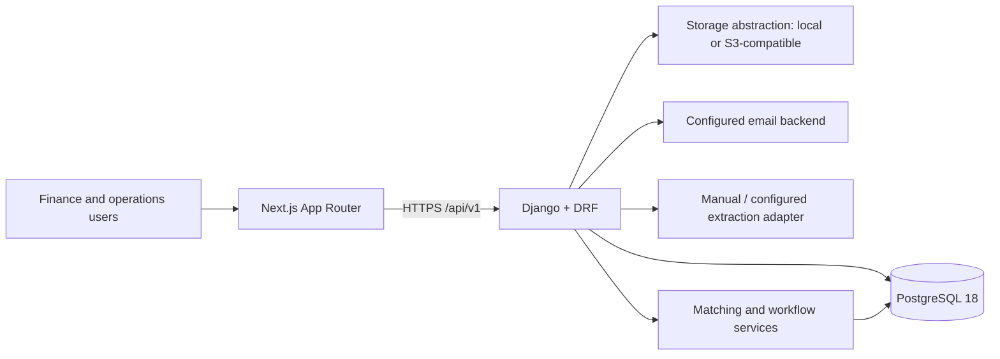
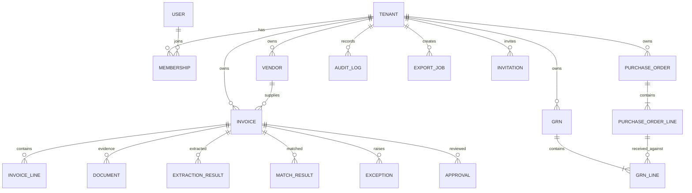

# KriyoPay Architecture

The proposed architecture for the adjacent transport fleet and driver-finance module is documented in [TRANSPORT_FLEET_ARCHITECTURE.md](TRANSPORT_FLEET_ARCHITECTURE.md). It is a target design and is not yet implemented.

## System overview

## Invoice-to-export request flow

1. Authenticated user uploads a supported file; API validates tenant membership, type, size, and checksum, writes a tenant-scoped document, creates an invoice, and records an audit event.
2. Extraction uses the configured adapter; the default development path is manual review. Failure or low confidence leaves the invoice available for manual review.
3. Finance confirms/corrects fields. The API records an invoice version and correction audit event, then a matching run evaluates vendor, PO, GRN, quantity, rate, tax, TDS, duplicate, and approval rules.
4. Matching stores explainable results and exceptions. Users assign and resolve exceptions with notes; overrides require a reason and audit entry.
5. Finance submits an eligible invoice for approval. An authorized approver approves/rejects the exact invoice version; notification is sent via email.
6. Export service validates approved state and balanced debit/credit totals, creates a CSV ExportJob, stores/downloads the artifact, marks invoices exported, and records audit events.

## Frontend architecture

- Next.js 14+ App Router with TypeScript strict mode, Tailwind CSS, and shadcn/ui primitives.
- Route groups: `(auth)` for login/signup; `(app)` for dashboard, invoices, procurement, exceptions, approvals, vendors, users, audit, and settings. Layouts provide navigation and tenant context.
- Server Components for initial read-only page data where suitable; client components for upload, editable forms, filters, and interactive queues.
- A typed API client centralizes base URL, auth handling, serialization, pagination, and structured errors. No business rules are trusted to the browser.
- Keep server state at the API boundary; local component state for transient form edits, with explicit save/confirm actions. Show loading, empty, error, and permission-denied states.
- Protected pages require a valid authenticated session and tenant membership; API authorization remains authoritative.

## Backend architecture

Django project with domain apps: `tenants`, `accounts`, `vendors`, `procurement`, `invoices`, `documents`, `matching`, `exceptions`, `approvals`, `exports`, `audit`, and `notifications`.

- DRF views handle HTTP orchestration only; serializers validate all inbound payloads and represent output.
- Service classes own workflows and transactional boundaries; models enforce local invariants. Query/repository helpers require a tenant explicitly and expose tenant-filtered querysets.
- Use UUID primary keys; all tenant-owned rows include `tenant_id`. Django migrations define every schema change.
- Permission classes combine membership role with action-level rules. Auditors are read-only; only appropriate roles can edit, resolve, approve, or export.
- Use database transactions for state transitions and `transaction.on_commit` to enqueue dependent jobs.

## Multi-tenant isolation

Every business query is scoped by the authenticated membership’s tenant. Tenant identity comes from server-side membership, never a client-supplied tenant ID alone. URLs may use UUIDs, but object lookup always includes tenant. Storage keys include tenant and object identifiers; signed URLs are short-lived and only issued after authorization. Tests must attempt cross-tenant reads and writes for every major resource. PostgreSQL row-level security may be evaluated as defense-in-depth later; application-level scoping is mandatory in MVP.

## Background jobs and integrations

Phase 2 currently exposes a provider-neutral, tenant-token-authenticated email-ingestion webhook and explicit overdue-escalation action. There is no provider-specific mailbox polling, Celery/Redis worker, scheduled escalation runner, or dead-letter service in the current local build. Follow-up drafts are only sent when a user explicitly invokes send and SMTP is configured. Configure those integrations and scheduled workers for unattended production operation.

## File and document storage

Define a storage service interface with local development and S3-compatible implementations. Store original bytes, checksum (SHA-256), MIME type, size, tenant, uploader/source, and timestamps in `Document`; keep file bytes outside PostgreSQL. Restrict accepted formats to PDF, JPEG, PNG, and HEIC, enforce size limits, inspect actual content type, and generate opaque object keys. Originals are retained as evidence; document deletion is restricted and audited.

## Extraction adapter

## Phase 2 architecture and scope

### Delivery status and boundaries

- **Implemented MVP:** tenant-scoped invoice intake, manual review, matching, exceptions, single-step approval, audit, and Tally CSV. Extraction defaults to the manual adapter.
- **Phase 2:** email-ingestion adapter/webhook, vendor alias suggestions, duplicate-check decisions, tenant matching/approval rules, guarded auto-approval, exception SLAs/escalations, vendor-follow-up drafts, payment allocations, credit/debit notes, custom fields, previewed bulk jobs, notifications, and reports.
- **Future/out of scope:** direct bank payment execution, direct Tally XML, WhatsApp delivery, provider-specific email polling, and third-party extraction unless the tenant configures and consents to a provider.

### New module boundaries

- `inbound_email` owns provider-neutral message/attachment normalization, idempotency, quarantine, and ingestion logs. Provider adapters hand normalized messages to a single tenant-scoped ingestion service.
- `matching` owns vendor candidate scoring, duplicate signals, configurable tolerance evaluation, and immutable match evidence.
- `approvals` owns approval-rule selection, maker-checker, delegation, step history, auto-approval eligibility, and rule-evaluation snapshots. Invoice state transitions remain transactional in the workflow service.
- `payments` owns the payment register, payment records/allocations, and credit/debit notes. An invoice outstanding balance is derived from approved net payable less active allocations and approved notes.
- `exceptions_app` owns SLA clock, priority, escalation history, and follow-up drafts. Notifications are queued as side effects after commit.
- `custom_fields`, `bulk_ops`, `notifications`, and `reports` own their definitions/jobs/preferences/query projections. Every query receives tenant scope from membership middleware/permission context.

### Automation safety

Rules are data, not executable code. Approval and auto-approval rules are tenant scoped and evaluated deterministically with maker-checker constraints. Webhook message IDs and bulk preview tokens protect retries and commits. Auto-approval requires an enabled explicit vendor whitelist and amount ceiling, successful matching, and no unresolved blocking exception or duplicate. Payment state is derived from approved net payable and recorded allocations.

### Phase 2 request flow

1. The authenticated email-ingestion webhook validates tenant routing and message identity, checks message/file idempotency, records sender/subject/message metadata, and stores supported attachments; unsupported files are logged for review.
2. Vendor matching returns candidates, confidence, and method; only a high-confidence match may preselect a vendor, and unknown vendors are never approved implicitly.
3. Duplicate and matching services emit explainable candidate signals and exceptions. A user decision is required to clear suspected duplicates.
4. The approval engine records selected rule, ordered approval steps, maker-checker constraints, delegates, SLA timestamps, and exact rule evaluations.
5. Eligible invoices flow to the payment-ready register. Payments and approved notes update derived outstanding balance through immutable allocations and audit events.
6. Notifications, bulk preview/commit operations, and report queries are tenant scoped and auditable. Provider delivery and background scheduling require deployment integrations.

### Phase 2 migrations and operations

Use additive Django migrations and PostgreSQL constraints for tenant uniqueness, nonnegative values, valid states, and payment allocations. Backfill before adding non-null columns. Local development targets host-based PostgreSQL 18; Docker is not required. PostgreSQL 18 execution must be verified in an environment with the server running; the current test suite is verified with its SQLite test setting.

`DocumentExtractionProvider` accepts a document reference and returns a versioned normalized schema: field values, confidence per field, line items, provider metadata, and warnings. Provider implementations are selected via environment configuration; credentials are environment-only. A deterministic fake/manual provider supports development and tests. Never let extraction change approval state. Failure or low confidence creates `EXTRACTION_FAILED` or `REVIEW_REQUIRED` and preserves manual entry.

## Matching engine

Pure deterministic domain service receives invoice, vendor, PO, GRN, and tenant tolerances. It emits a versioned `MatchResult` with per-line comparisons, variance JSON, outcome, and generated exception candidates. It does not approve or mutate source procurement records. See `MATCHING_RULES.md`; unresolved ambiguity and any blocking exception prevent `MATCHED`/`PAYMENT_READY`.

## Exceptions, approval, and audit

Exception state changes use explicit service methods and allowed transition maps. Assignment, resolution, and override require authorization; overrides require a non-empty reason and preserve the original exception. Approval stores approver, decision, timestamp, comments, invoice version, and available IP/user-agent metadata. Immutable `AuditLog` rows are append-only at the application layer; DB permissions and admin restrictions should prevent ordinary update/delete. Audit events include actor, tenant, object type/id, action, timestamp, and minimal structured metadata.

## Security and observability

- HTTPS in deployment; secrets only in environment/secret manager; `.env` excluded from version control.
- Passwords managed by Django; JWT/session tokens have secure, HttpOnly, SameSite cookie policy where applicable, CSRF protection for cookie auth, expiry and logout/revocation handling.
- Role-based access, tenant-aware object permissions, least privilege for storage and database credentials, input validation, upload limits, and secure download links.
- Encrypt disks/storage and database backups at rest; TLS for network connections. Minimize sensitive content in logs; financial documents and GSTINs are restricted to tenant users.
- Structured logs with request ID, tenant ID, actor ID, and job ID; metrics for API errors, queue depth/age, extraction latency/failures, and workflow counts. Alert on sustained job failures and storage/database issues.
- Retry transient errors only; expose user-actionable failures. Preserve failed jobs and import row diagnostics for support.

## Database ERD

All tenant-owned entities have UUID PK and tenant FK (including child records, audit, notifications, and export/import artifacts). Details and constraints are in `DATA_MODEL.md`.

## API contract

Versioned JSON REST under `/api/v1/`; DRF serializers validate requests. Authentication errors use 401, permission failures 403, missing or cross-tenant resources 404, validation 400/422, conflicts in invalid state 409, and unexpected failures 500 with a request ID. Paginate list endpoints and support documented filters/order fields. Full schemas and endpoint list are in `API_SPEC.md`.

## Deployment architecture

Local development runs Next.js and Django directly on the host, connecting to PostgreSQL 18 and Redis services installed on the host or available on the local network. Container-based development and deployment are deferred for now. Production may run frontend and Django as separate managed services behind TLS ingress, with managed PostgreSQL/Redis and S3-compatible storage. Keep secrets in the deployment environment and run migrations as a controlled release step.

## Testing strategy

Pytest for domain services, serializers, permissions, tenant isolation, state transitions, jobs, and export reconciliation. Frontend Vitest/React Testing Library for components and form/permission states. E2E acceptance tests should cover upload/manual entry through matching, exceptions, approval, and export, using synthetic tenant data and fake extraction. CI runs lint, type checking, tests, and migration checks.
