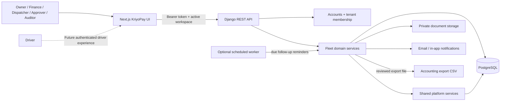
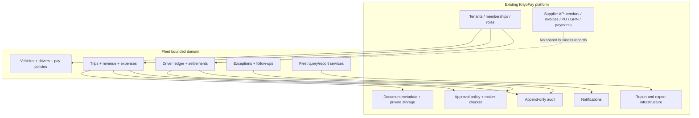
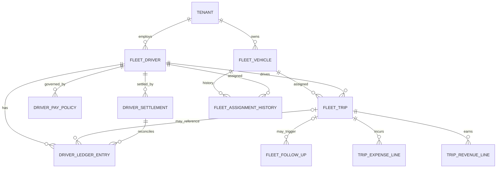
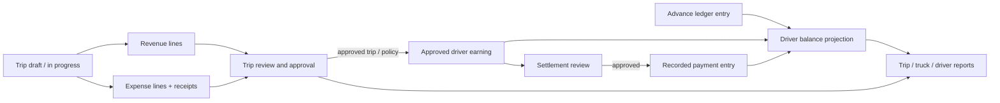

# KriyoPay Transport Fleet Module Architecture

## 1. Design goal

Add truck, trip, trip-cost, driver-ledger, settlement, and follow-up workflows as a bounded domain in the existing KriyoPay application. Reuse authentication, tenant isolation, document storage, audit, notifications, approval policy, and reporting infrastructure. Keep fleet records and driver liabilities separate from supplier invoices and vendor payment allocations.

This is a target design for phased implementation. It does not describe functionality already present in the current product.

## 2. System context



The first release is staff-operated. A driver portal or app is a later client of the same API and must authenticate each driver with narrowly scoped access.

## 3. Domain boundaries



The fleet app owns fleet-specific rules and records. Shared services provide infrastructure and generic control primitives. It may use the shared audit log and approval engine, but fleet state transitions remain in fleet workflow services. Supplier `Payment` and `PaymentAllocation` records represent vendor liabilities and must not be reused for driver balances.

## 4. Backend placement and request flow

### Suggested app structure

Create a bounded Django app, for example `backend/fleet/`, containing:

- `models.py`: fleet entities, constraints, and indexes.
- `serializers.py`: request validation and response representations.
- `permissions.py`: membership roles and fleet action capabilities.
- `selectors.py` or query services: tenant-scoped reads and report projections.
- `services/`: transactional workflows for trip, expense, ledger, settlement, and follow-up transitions.
- `views.py` and `urls.py`: thin DRF endpoints under `/api/v1/fleet/`.
- `migrations/`: additive schema changes only.

Register the app in Django settings and include its URL routes in `backend/config/urls.py`. Use the existing UUID, timestamp, tenant FK, authentication, error, pagination, and request-ID conventions. Exact naming should follow the repository’s current patterns when implementation starts.

### Write request flow

```mermaid
sequenceDiagram
  actor User
  participant UI as Next.js Fleet page
  participant API as DRF endpoint
  participant Perm as Tenant + capability check
  participant Svc as Fleet workflow service
  participant DB as PostgreSQL
  participant Audit as Shared audit service
  participant Side as Notifications / jobs

  User->>UI: Submit trip or settlement action
  UI->>API: Authenticated request + active workspace
  API->>Perm: Resolve membership and action permission
  Perm-->>API: Authorized tenant context
  API->>Svc: Validated command + tenant + actor
  Svc->>DB: Begin transaction; lock and validate related rows
  Svc->>DB: Apply allowed transition / append ledger entry
  Svc->>Audit: Record actor, action, reason, object and change summary
  Svc->>DB: Commit
  Svc->>Side: Enqueue post-commit reminder or notification if needed
  API-->>UI: Updated resource and derived totals
```

Tenant identity is resolved from authenticated membership context, never trusted from a client-supplied tenant field. Every object lookup includes both tenant and object identifier. Cross-tenant objects should behave as not found.

## 5. Data architecture

All new business tables include `tenant_id`, UUID primary keys, timestamps, and appropriate tenant-scoped uniqueness. Amounts use `NUMERIC(18,2)` and remain INR in the first version. Store source evidence in private document storage and link through authorized document metadata; do not store file bytes in PostgreSQL.



### Entity ownership

| Entity | Owner and purpose |
| --- | --- |
| `FleetVehicle` | Fleet directory; registration identity, active state, and optional ownership/capacity details. |
| `FleetDriver` | Driver directory; contact/reference details and optional link to a KriyoPay user if a secure driver login is later introduced. |
| `DriverPayPolicy` | Effective-dated agreed pay basis and rate. A calculation stores the policy/version and input snapshot used. |
| `FleetTrip` | Truck/driver assignment, route, dates, customer reference, odometer readings, review state, and trip totals/projection inputs. |
| `TripRevenueLine` | Evidence-backed trip revenue components; actual, estimated, and review state remain explicit. |
| `TripExpenseLine` | Expense category, amount/date/payee, budget, payment reference, receipt, approval state, and exception data. |
| `DriverLedgerEntry` | Append-only earning, advance, payment, deduction, and reversal entries. This is the source of driver balances. |
| `DriverSettlement` | Pay-period workflow and reconciliation of eligible ledger entries into a payable amount. |
| `FleetFollowUp` | Assigned, due-dated action with status, related fleet object, requested evidence, and resolution record. |
| `FleetAssignmentHistory` | Optional dispatch/vehicle-driver assignment history independent of a single trip. |

Use typed relational fields for amounts, dates, states, references, and categories. JSON is appropriate for a bounded policy snapshot or audit metadata, not for replacing the ledger or line-item tables. Validate same-tenant parent links in service methods; add composite constraints where current Django patterns support them.

## 6. Financial state and calculation flow



- Trip margin = approved actual revenue − approved actual trip expense. Incomplete or provisional values are labeled and excluded from approved totals.
- Driver balance = opening payable + approved earnings − approved advances − approved deductions − approved payments. A negative result is shown as a recoverable/advance balance.
- Balance is derived from ledger entries; do not maintain a separately editable balance column as the financial source of truth.
- Posted financial entries are immutable. Corrections append reversing/adjusting entries linked to the original with a reason.
- Settlement approval snapshots eligible entries and totals. Payment recording is idempotent and cannot silently alter the approved settlement.
- Do not infer fraud. Exceptions state observable conditions such as “receipt missing” or “actual exceeds budget by configured threshold.”

## 7. State transitions and controls

### Trip

`DRAFT -> IN_PROGRESS -> SUBMITTED -> APPROVED`

`SUBMITTED -> REJECTED -> DRAFT` (with reviewer reason)

An approved trip is corrected through a controlled adjustment/reopen action, with a reason, permission check, and audit record. Avoid silently editing approved source values.

### Expense

`DRAFT -> SUBMITTED -> APPROVED | REJECTED`

Receipt policy and variance thresholds may create exceptions. A waiver requires authorized actor and reason. Expense approval does not itself create a driver payment.

### Driver settlement

`DRAFT -> SUBMITTED -> APPROVED -> PART_PAID | PAID`

`SUBMITTED -> REJECTED -> DRAFT`; cancellation or corrections after approval use explicit cancel/reversal records and audit history.

Approval engine may supply rules and maker-checker checks, but fleet services validate the domain eligibility and perform state transitions transactionally. Keep high-value expense and settlement approval thresholds tenant-configurable. No AI result, notification, follow-up completion, or external message can approve a financial record.

## 8. API surface

Suggested REST resource families (confirm exact conventions from existing `API_SPEC.md` before implementation):

| Resource | Main operations |
| --- | --- |
| `/api/v1/fleet/vehicles/` | List, create, update, deactivate, detail. |
| `/api/v1/fleet/drivers/` | List, create, update, deactivate, detail. |
| `/api/v1/fleet/pay-policies/` | Create and review effective-dated driver pay rules. |
| `/api/v1/fleet/trips/` | List/filter, create draft, edit eligible fields, detail. |
| `/api/v1/fleet/trips/{id}/submit` | Submit a trip and its evidence for review. |
| `/api/v1/fleet/trips/{id}/approve` and `/reject` | Authorized, reasoned review transitions. |
| `/api/v1/fleet/trips/{id}/revenue/` and `/expenses/` | Manage line items while state permits; upload/link evidence. |
| `/api/v1/fleet/drivers/{id}/ledger/` | Read-only, paginated ledger and balance breakdown. |
| `/api/v1/fleet/settlements/` | Create period draft, calculate eligible entries, submit, approve, record payment, reverse. |
| `/api/v1/fleet/follow-ups/` | Create, assign, update status, resolve/waive with evidence/reason. |
| `/api/v1/fleet/reports/*` | Tenant-scoped summaries with date, truck, driver, status, and category filters. |

Use explicit command endpoints for approval/settlement transitions rather than allowing arbitrary state updates in generic `PATCH` requests. Apply pagination, validated filter fields, structured errors, and idempotency keys for payment/settlement mutations.

## 9. Frontend integration

Add a protected `/fleet` section to the existing Next.js `(app)` route group, retaining workspace context and typed API-client conventions. Suggested pages:

- `/fleet` overview dashboard.
- `/fleet/vehicles` and `/fleet/drivers` directories.
- `/fleet/trips` list/queue and `/fleet/trips/[id]` review detail.
- `/fleet/settlements` with driver ledger and period reconciliation.
- `/fleet/follow-ups` queue.
- `/fleet/reports` trip, truck, expense, and driver-balance reports.

The trip detail page should bring route, truck/driver assignment, revenue, expenses, receipts, exceptions, approval history, and follow-ups into one review context. Distinguish estimated, submitted, approved, and paid amounts. Enforce action permissions in the UI for clarity while treating API authorization as authoritative. First release can be desktop-first; if drivers must submit evidence from a phone, validate and design a mobile-friendly authenticated flow before adding driver roles.

## 10. Documents, notifications, and jobs

- Receipts use existing private document storage and document authorization, with fleet object type/reference metadata. Only authorized members may upload, preview, or download.
- In-app notifications can announce an assigned follow-up, rejected trip, or settlement waiting for approval. Notification delivery is a side effect after database commit.
- A scheduled worker is optional for reminder delivery and aging summaries; current repository docs describe background scheduling as deployment-dependent. Keep user-triggered queues usable without a scheduler.
- Driver-facing email/WhatsApp/SMS is a later integration: require contact verification/consent where applicable, reviewed message content, explicit send action, provider delivery state, and audit. A reminder is never a payment or approval action.

## 11. Reporting and accounting export

Report queries read from tenant-scoped fleet records and ledger projections. Include status and source-date semantics in every export. Add a fleet export adapter only after agreeing with the customer's accountant on required Tally/import fields and mapping. Do not route fleet expenses through supplier invoice exports or vendor payments by default: their voucher type and ledger treatment may differ. Reconcile debits/credits and counts before exposing a file as accounting-ready.

## 12. Security, reliability, and operations

- Enforce tenant scope at query and mutation boundaries; check tenant equality for every related object and document.
- Keep driver personal data to the minimum needed and define retention/visibility policy before a driver portal.
- Add indexes for `(tenant_id, status)`, `(tenant_id, vehicle_id, starts_at)`, `(tenant_id, driver_id, effective_at)`, and `(tenant_id, due_at, status)` as supported by access patterns.
- Use database transactions and row locks for settlement eligibility, approval, and payment posting to prevent concurrent double settlement.
- Prevent overlapping active truck/driver trips in service validation; consider exclusion constraints only if database support and current conventions warrant them.
- Use idempotency keys for imports and financial posting endpoints; duplicate retries must return the existing result or a clear conflict.
- Audit financial state transitions, policy changes, exports, and overrides with actor, time, reason, and stable object IDs. Avoid receipt bytes and unnecessary personal data in logs.
- Back up new tables and document objects under existing retention policy. Use additive migrations and controlled releases.
- Track operational metrics: trip submissions/approval aging, missing receipt rate, failed notifications, settlement discrepancies, and export reconciliation failures.

## 13. Phased integration sequence

### Stage 0 — validate policies and accounting outputs

Confirm trip definitions, expense categories, salary basis, pay period, advance/deduction handling, receipt thresholds, approvers, and accounting export. Walk through representative historic trips and sample driver balances.

### Stage 1 — fleet directory and trip cost control

Add the `fleet` app foundation, tenant-scoped vehicle/driver/trip/line-item tables, receipt linking, trip submit/review, exceptions, follow-ups, and basic trip profitability UI/report. Staff enter records manually. Driver ledger remains out of this stage.

### Stage 2 — driver ledger and settlement

Add pay policies, immutable ledger entries, advance/payment recording, settlement workflow, maker-checker, and driver-balance reports. Reconcile a sample pay period with finance before production use.

### Stage 3 — reminders, driver self-service, and integrations

Add scheduled reminders and optionally a narrowly scoped driver portal. Add messaging, fuel-card/FASTag/GPS, or accounting integrations only after validating provider support and data mapping.

## 14. Architecture acceptance checks

- Fleet APIs reject missing membership and cross-tenant object/document references.
- Fleet app can migrate and operate alongside AP without altering supplier invoice/payment semantics.
- Approved trip and settlement transitions are transactional, auditable, and maker-checker aware.
- Driver balances reconcile exactly to immutable ledger entries; retries do not duplicate entries.
- Reports distinguish estimates, pending review, approvals, and recorded payments.
- Receipts remain private and tenant-authorized.
- UI remains usable when reminder workers or external messaging providers are unavailable.
- Sample trip and pay-period exports reconcile to the customer-validated accounting format before rollout.
