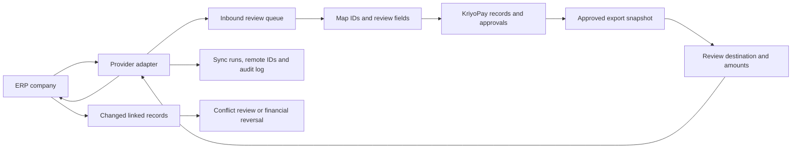

# KriyoPay ERP integration architecture and setup

Target systems: **Microsoft Dynamics 365 Finance**, **ERPNext**, **TallyPrime**, and **Zoho Books**, with an additional **Zoho Inventory** companion connection for goods receipts.

The requested scope covers supplier import, reviewed invoice exports, direct accounting-record creation, and two-way exchange of purchase orders, goods receipts, invoices and payment records. This implementation supplies the connection, staging, review, mapping, import, export and reconciliation framework. It has not been certified against a customer ERP. Existing-record changes, cancellations and posted financial corrections need human review; there is no automatic overwrite of posted history.

## What is available

Open **Integrations → ERP & accounting** at `/integrations/erp`.

- Separate connections for each workspace and ERP company/legal entity.
- Encrypted credentials; API responses never return credential values.
- Connection tests independent from accounting sync outcomes.
- Manual, paginated imports for supported resources, with Celery history and an explicit next-page action.
- Optional scheduled imports, disabled by default.
- A review inbox with original source data and editable canonical import fields.
- Explicit local-record links so repeat imports do not create the same record again.
- Incoming changes to linked records become conflicts. Reviewers can retain local values and record their decision.
- Imported suppliers are unapproved, POs are drafts, receipts await quality review, and invoices require review. Existing approval steps remain required.
- Imported payments require explicit allocations, a positive amount, confirmation that the ERP payment is posted, and sufficient invoice balance. Importing a payment cannot bypass invoice readiness or pay an invoice twice.
- Outbound snapshots for approved suppliers/POs, accepted receipts, payment-ready invoices and recorded payments.
- Explicit send confirmation, checks for source/mapping changes, remote IDs and audit history.
- A failed or timed-out financial POST becomes UNKNOWN. The user checks the ERP and records its reference; the application does not automatically repeat that POST.
- Tally XML downloads for supplier masters and accounting purchase/payment vouchers.

## Capability matrix

| System | Inbound reads and reviewed local creation | Direct outbound creation | Setup still needed |
|---|---|---|---|
| Dynamics 365 Finance | Configured supplier, PO, receipt, invoice and payment OData entities | Suppliers; configured atomic header/line batches and journal mappings | Verify collections, keys, fields, financial dimensions, item/category, journal and tax/withholding mappings against the customer's metadata |
| ERPNext | Suppliers, Purchase Orders, Purchase Receipts, Purchase Invoices, Payment Entries | Supplier masters and **draft** PO/receipt/invoice/payment documents | Dedicated API user, company, item IDs, tax and payable/bank accounts, receipt-to-PO-row references |
| TallyPrime | Supplier ledgers, Purchase Order/Receipt Note/Purchase/Payment vouchers | Supplier ledgers and accounting Purchase/Payment vouchers; XML download also available | Tally running with the exact company loaded, approved endpoint and ledgers. Inventory PO/receipt **writes remain unimplemented** |
| Zoho Books | Vendor contacts, purchase orders, bills and vendor payments | Vendor contacts, purchase orders, bills and vendor payment records | OAuth grants, data centre, organization, expense/bank accounts, tax IDs and India GST configuration. Goods receipts use the separate **Zoho Inventory companion connector** |

| Zoho Inventory | Vendor contacts, purchase orders and purchase receives | Purchase receives linked to the correct PO and PO line IDs | Separate Inventory OAuth scopes, organization and receipt-to-PO-row mappings; link existing local masters/orders instead of duplicating Books imports |

Direct ERPNext/Zoho invoice export blocks TDS invoices until a provider withholding extension is implemented. Finance template mappings and Tally ledger exports can carry explicit withholding values, but the customer's accountant must validate their treatment. Draft status is enforced for ERPNext; other ERPs determine document status according to their own rules. Payment exports create accounting records; they do not initiate a bank transfer.

## Data flow



### Ownership and corrections

An ERP import does not confer local approval. A remote payment is imported only when it is actually posted and has been reviewed. Existing local records can be linked using `local_id` instead of recreated. A subsequent remote change never silently edits that linked record. The reviewer uses normal correction/reversal workflows, then acknowledges the difference in the ERP queue. Remote deletion, automatic update merging, automatic cancellation propagation and automatic approval/status propagation are **not implemented**.

## Connection setup

### Shared requirements

Use an unrestricted workspace Owner or Finance account. Auditors can inspect the queue. Branch-scoped users cannot access company-wide ERP data. Workspaces with subscriptions need the existing **API access** entitlement enabled in Super Admin → company feature access. Resource-specific plan checks also apply when importing local records.

Set `ERP_CREDENTIALS_KEY` to a Fernet key, or retain the existing `WEBHOOK_FERNET_KEY` fallback. Keep that key stable and include it in secured recovery backups; changing it makes saved credentials unreadable. Store credentials through the connection form.

Run the backend migration and restart the backend, Celery worker and beat after deployment:

```powershell
cd backend
.\.venv\Scripts\python.exe manage.py migrate erp
```

The local migration has been applied. No customer ERP credentials have been entered and no external accounting write has been performed during implementation.

### Dynamics 365 Finance

Provide the Finance environment origin, Entra tenant ID, application client ID/secret and legal entity (`dataAreaId`). Register the application under Finance's Microsoft Entra applications and map it to a dedicated service user with appropriate permissions. The connector uses client credentials, reads `/data/$metadata` for its connection test, and enforces the selected legal entity on reads and writes.

Use advanced settings for explicit entity definitions, for example:

```json
{
  "entities": {
    "suppliers": {
      "collection": "VendorsV2",
      "key_fields": ["dataAreaId", "VendorAccountNumber"]
    }
  }
}
```

Collection names and field names are environment-specific. Do not assume similarly named entities have identical fields. Invoice headers without their lines must not be treated as complete invoice imports.

For compound outbound records, configure `document_maps` with a header collection/template, a line collection/template, and a stable external reference. Templates support explicit paths such as `{{source.invoice_number}}`, `{{source.id}}`, `{{vendor_id}}`, `{{legal_entity}}`, `{{line.taxable_value}}` and `{{line_number}}`. They do not evaluate code. `source` is the reviewed KriyoPay snapshot; `line` is one snapshot line. Include the same stable reference in header and line mappings according to your customer's schema.

These operations are sent in one OData batch changeset. Every returned operation must succeed before the application records SENT. Finance server metadata, integration user permissions, dimension formats, journal types and transaction boundaries need sandbox verification by the implementation partner. Returned row errors or uncertain responses require reconciliation.

### ERPNext

Provide the site origin, exact company name and a dedicated integration user's API key/secret. The connector verifies company access and uses Frappe resource endpoints. The API user needs read permissions for imports and create permissions for outbound drafts.

Example advanced account mappings (replace all values with actual ERP names):

```json
{
  "item_map": {"LOCAL-ITEM-CODE": "ERP-ITEM-CODE"},
  "receipt_line_map": {"LOCAL-PO-LINE-UUID": "ERP-PO-ITEM-ROW-ID"},
  "defaults": {
    "invoices": {"tax_account": "Input GST - COMPANY", "credit_to": "Creditors - COMPANY"},
    "purchase_orders": {"tax_account": "Input GST - COMPANY"},
    "receipts": {"tax_account": "Input GST - COMPANY"},
    "payments": {"paid_from": "Bank - COMPANY", "paid_to": "Creditors - COMPANY"}
  }
}
```

Map supplier records first, then documents and allocations. Submitted ERP payments can be imported; a draft payment entry is not proof of payment. Local receipts need the correct PO and PO-line references before outbound preparation. Receipt creation does not automatically mark stock quality accepted.

### Zoho Books

Provide the organization ID, OAuth client ID, client secret, refresh token and correct data centre (`in`, `com`, `eu`, `com.au`, `jp`, `ca`, `com.cn` or `sa`). The current setup accepts a refresh token created through your Zoho OAuth app; a browser-based consent wizard is **not implemented**. Access tokens refresh automatically and are cached until near expiry.

Grant only the required organization, contact, purchase-order, bill and vendor-payment scopes, including CREATE only where outbound writes are needed. Use IDs from that exact organization:

```json
{
  "tax_map": {"18": "ZOHO-TAX-ID"},
  "defaults": {
    "invoices": {"account_id": "EXPENSE-ACCOUNT-ID"},
    "purchase_orders": {"account_id": "PURCHASE-ACCOUNT-ID"},
    "payments": {"account_id": "BANK-ACCOUNT-ID"}
  }
}
```

Review GST treatment, place of supply, tax IDs and supplier currency with the accountant. Multi-currency conversion and country-specific tax certification are not implemented. For warehouse receipts, add the Zoho Inventory companion connection with its own Inventory-authorized refresh token and organization ID. Import Inventory suppliers and POs and link them to existing local records using local_id. Map each local PO-line UUID to the Inventory line_item_id in receipt_line_map. The connector sends purchase receives to /inventory/v1/purchasereceives with purchaseorder_id in the query and explicit received quantities in line_items. The receive_id returned by Inventory is stored in sync history. A Books refresh token is not presumed to carry Inventory scopes.

### TallyPrime

Enable the HTTP server in Tally and keep the exact company loaded. For a local backend an operator can approve the specific gateway in the root `.env`, then restart backend and worker:

```dotenv
ERP_TRUSTED_ORIGINS=http://127.0.0.1:9000
```

The allowlist contains exact origins, not wildcards. Public integrations require HTTPS; private/local endpoints are rejected unless explicitly approved. Connections pin validated addresses, retain TLS host verification and do not follow redirects. A cloud backend cannot reach a client's localhost; a secured client-side bridge/VPN is required and **a packaged Tally bridge agent is not implemented**. Do not publicly expose Tally's port.

Example advanced ledger mappings:

```json
{
  "supplier_groups": ["Sundry Creditors"],
  "defaults": {
    "invoices": {
      "purchase_ledger": "Purchases",
      "gst_ledger": "Accountant-reviewed GST ledger",
      "tds_ledger": "TDS payable"
    },
    "payments": {"bank_ledger": "Company Bank"}
  }
}
```

The generated purchase/payment documents are balanced accounting vouchers. Inventory allocation, full GST statutory reporting and automatic CGST/SGST/IGST splitting are not implemented. Use accountant-reviewed tax ledgers and a Tally test company before sending. Stable GUID/REMOTEID values and the local send fence help prevent repeat sends, but do not substitute for inspecting an unknown Tally import result. HTTP 200 alone is not treated as successful import; exactly one created record without import errors is required.

## Automatic imports

Optional advanced configuration:

```json
{
  "sync_interval_minutes": 15,
  "sync_resources": ["suppliers", "purchase_orders", "invoices", "payments"]
}
```

The scheduler runs every minute. The interval may be 5–1440 minutes; 0 disables it. Each job reads a page; subsequent pages continue in later scheduler passes. Finance resources without configured entities are skipped. Jobs stop if the connection or workspace is disabled, billing/API entitlement is lost, or the integration owner loses unrestricted finance access. The service never automatically posts outbound financial records.

Maintenance releases imports and sends unchanged for 15 minutes. Import jobs can be restarted; an unresolved outbound send requires reconciliation. Maintenance needs a functioning worker; production monitoring should separately detect a fully stopped worker or broker.

## API and data storage

- `/api/v1/erp/connections`: catalog, saved connections, encrypted credential setup.
- `/connections/{id}`: edit, inspect or disconnect.
- `/connections/{id}/test`: read-only connection verification.
- `/runs`: import jobs and pagination history.
- `/local-records`: searchable, paginated eligible local records.
- `/records`: inbox/outbox and reviewed outbound snapshots.
- `/records/{id}`: inspect and apply reviewed inbound values.
- `/records/{id}/download`: review JSON or supported Tally XML.
- `/records/{id}/send`: explicitly confirmed ERP creation.
- `/records/{id}/reconcile`: record a verified remote reference after manual import or uncertain outcome.
- `/records/{id}/review-conflict`: acknowledge a source change while retaining local history.

`ERPConnection` holds the provider, company-specific configuration and encrypted credentials. `ERPSyncRun` records each imported page and its outcome. `ERPRecord` stores stable provider IDs, local links, source snapshots, reviews and send state. Read limits, stable identifiers and uniqueness constraints protect import replay. Pulls do not infer deletion from an absent row.

## Remaining work for complete production two-way operation

1. Connect real sandbox accounts for each customer; validate versions, service permissions, entity shapes and accountant-approved mappings.
2. Implement Tally inventory PO/receipt posting and the deployable local bridge agent.
3. Complete live Zoho Inventory receipt validation and implement the Zoho browser OAuth consent flow. The Inventory adapter and reviewed receipt creation are implemented.
4. Add provider-specific TDS, GST split/statutory and currency handling where currently blocked or limited.
5. Add controlled update/cancellation propagation and reconciliation of approval/posting states. Current linked-record changes enter conflict review rather than automatic merging.
6. Add customer-specific purchase-order/receipt line expansion and normalization for Finance/Tally. Current source snapshots require reviewed canonical fields where layouts differ.
7. Define separate account/dimension mappings for fleet trip costs and driver settlements if those should also post into the ERP.
8. Complete real sandbox round trips, load/rate-limit checks, operational monitoring, retention and recovery checks before production use.

## Sources

Implementation checks passed: 28 ERP backend tests using stubbed provider network boundaries, 6 existing sidebar-access tests, frontend TypeScript validation, Django system checks and migration consistency checks. Both local migrations were applied and the tracked worker/scheduler restarted with ERP tasks registered. Real ERP connectivity and round-trip accounting correctness remain unverified until sandbox accounts and reviewed mappings are available.

- [Microsoft Finance OAuth/service integration](https://learn.microsoft.com/en-us/dynamics365/fin-ops-core/dev-itpro/data-entities/services-home-page)
- [Microsoft Finance OData, batches and company filtering](https://learn.microsoft.com/en-us/dynamics365/fin-ops-core/dev-itpro/data-entities/odata)
- [Frappe REST authentication and resources](https://docs.frappe.io/framework/user/en/api/rest)
- [Zoho Books OAuth and data centres](https://www.zoho.com/books/api/v3/oauth/)
- [Zoho Books bills](https://www.zoho.com/books/api/v3/bills/)
- [Tally XML integration](https://help.tallysolutions.com/developer-reference/integration-capabilities/method-specific-integration/xml/)

- [Zoho Inventory purchase receives](https://www.zoho.com/inventory/api/v1/purchasereceives/)
