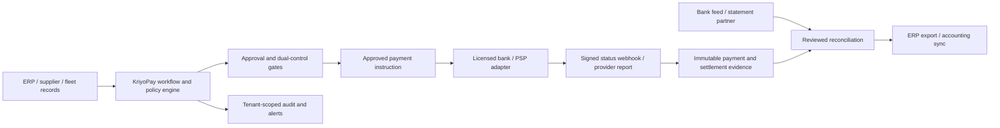

# KriyoPay global payments strategy — product fit

**Assessment date:** 27 October 2026  
**Source:** User-provided global expansion prompt  
**Decision:** Adapt the strategy to KriyoPay's current product. Do not reposition the current release as a global payment gateway or crypto wallet.

## Executive summary

The source prompt describes a cross-border payment service that accepts customer money, holds multi-currency balances, converts FX and pays merchants. KriyoPay currently solves a different, valuable problem: it controls business finance workflows around supplier invoices, approvals, purchase orders, fleet costs, driver settlements, ERP records and bank reconciliation.

The strongest fit is to make KriyoPay a **finance operations and payment-control layer for SMEs and logistics businesses**, connected to licensed banks, payment service providers and accounting systems. KriyoPay should prepare, authorize, track and reconcile payments while a regulated provider executes money movement. This preserves the current product and avoids taking on custody, licensing and crypto obligations before there is customer demand, legal advice and a provider relationship.

The immediate product opportunity is not to add every rail in the source prompt. It is to make today's invoice-to-payment and trip-to-settlement workflows work across supported ERP and bank/provider accounts with strong evidence, reliable reconciliation and clear human approval controls.

## Build status — supplier payout control foundation

The first implementation slice is implemented locally in **Payables → Payment register**. Finance can request a payout instruction for an approved invoice, and a different Owner, Finance user or Approver can approve/reject it. The request is idempotent, rechecks invoice status, supplier approval, blocking exceptions and balance at approval time, and writes each decision to audit history. A changed balance makes an instruction stale. This separate workflow does not create a `Payment`, mark an invoice paid, store bank-account credentials or initiate a transfer. Migration `payments.0005_payoutinstruction` is applied locally and must be applied in each deployed environment.

This is the control and workflow layer only. The first real-money integration still needs a selected bank/PSP, customer/provider sandbox credentials, beneficiary validation, signed status callbacks, provider reconciliation evidence and a controlled pilot. Driver salary payout instructions and multi-currency operational ledger work are not included in this first slice.

## What KriyoPay already has

| Existing capability | Current boundary |
| --- | --- |
| Invoice upload, automatic extraction, review, matching, exceptions and approvals | Extraction output is not a final accounting or payment decision; review and policy gates remain. |
| Supplier payables and recorded invoice payments | The payment register records allocations. It does not send a supplier bank transfer. |
| Fleet orders, trips, proof of delivery, expenses and driver settlements | Operational settlement records are currently INR-centric; payment records do not transfer money. |
| Bank reconciliation | CSV/XLSX import, source provenance, saved evidence and reviewed matching are available; no live bank feed is implied. |
| Settlement source observations | INR, USD, EUR, GBP, AED, SGD, AUD and CAD evidence can be stored separately. This is not a multi-currency operational ledger, FX conversion, or cross-currency matching. |
| ERP integration framework | Dynamics 365 Finance, ERPNext, TallyPrime, Zoho Books and a Zoho Inventory companion have connection/import/export/review capabilities. Customer sandbox validation and mappings remain necessary. |
| KriyoPay subscription checkout | Razorpay is used for KriyoPay plan billing; these platform subscription credentials are separate from client merchant money. |
| Tenant roles, audit records and operational automation | These are foundations for customer controls; global compliance certifications and jurisdictional licensing are not established by these features. |

See [README](../README.md), [ERP integration setup](erp-integrations.md), [settlement source foundations](settlement-source-foundations.md), and [reconciliation evidence](reconciliation-evidence-and-groups.md) for implementation boundaries.

## Product fit by source-prompt capability

| Source-prompt capability | Fit | KriyoPay adaptation |
| --- | --- | --- |
| Merchant onboarding, KYB, roles and account management | **High, adjacent** | Strengthen company setup, beneficial-owner/business verification handoff, workspace roles, approval limits and audit exports. A KriyoPay tenant account is not a regulated merchant account. |
| Invoices, approvals, refunds/chargebacks | **High for invoices and approvals; low for acquiring disputes** | Keep AP invoice processing and supplier-payment controls. Add refund/chargeback workflows only when connected provider data and customer evidence justify them. |
| Payment links, checkout and recurring billing for customers | **Low for current product** | Do not build a merchant checkout stack yet. Consider a provider-hosted customer collection link for KriyoPay fleet receivables only after a licensed PSP integration is selected. |
| Fiat acceptance and local payment methods | **Partner-led, later** | Show payment initiation and result from provider APIs; do not collect or custody funds directly. Start with a single customer/provider use case. |
| Crypto acceptance, wallets and blockchain payouts | **Poor fit now** | Defer. It introduces custody/VASP, sanctions, Travel Rule, chain monitoring and irreversibility concerns, while not improving the current invoice-to-payment workflow enough to justify the risk. |
| Multi-currency balances and FX conversion | **Medium-term foundation** | First add explicit currency to operational invoices, payments, collections and ledger entries, plus source account and FX evidence. Never add a displayed “wallet balance” until a true, reconciled double-entry ledger and provider-backed balances exist. |
| Supplier, contractor and driver payouts | **High workflow fit, partner execution** | Prepare approved payout batches, check beneficiaries, apply dual control, send through a licensed bank/PSP, consume signed status webhooks, and reconcile the actual debit. Keep manual payment recording available. |
| Payment orchestration and smart routing | **Later** | Begin with a provider adapter and explicit routing rules. No algorithmic routing until there are multiple contracted providers, measured outcomes and safe failure/retry semantics. |
| Bank feeds and reconciliation | **High** | Extend the current reviewed import process through an open-banking/aggregator partner. Keep imported evidence, matching and confirmation distinct from money movement. |
| APIs, webhooks, sandbox and plugins | **Medium/high** | Stabilize versioned public APIs, scoped keys, event delivery and customer sandbox. Prioritize ERP/accounting and logistics connectors before storefront plugins. |
| Tax documents and statutory compliance | **Adjacent** | Export operational evidence and support configurable fields. Do not present tax arithmetic checks as statutory validation or filing. |

## Recommended positioning and first customer profile

**Positioning:** “KriyoPay helps finance teams control, execute through their chosen payment partners, and reconcile supplier and fleet payments.”

Prioritize Indian SMEs and transport/logistics businesses that have recurring supplier invoices, vehicle expenses, driver settlements and an accounting system. This is the closest match to the live feature set and provides a clear sales story: fewer invoice errors, controlled approvals, faster closeout and traceable payment evidence.

Secondary segments to validate after the core workflow: import/export operators and service businesses with recurring cross-border supplier invoices. SaaS sellers, marketplaces, gaming/Web3 companies and consumer-facing e-commerce checkout are not first-release targets because KriyoPay does not yet have acquiring, merchant balances, subscription collection or dispute operations.

## Country entry recommendation

These are **qualitative sequencing estimates**, not market-size or compliance conclusions. “Fit” means fit for KriyoPay's current finance-workflow product, not total payments opportunity. Any live payment service requires current jurisdiction-specific counsel and a contracted, appropriately licensed provider.

| Rank | Market | Current-product fit | Suggested entry model | Why / gate |
| ---: | --- | --- | --- | --- |
| 1 | India | High | Sell current workflow product; connect customer ERPs and bank/payment partners | Existing INR invoice, fleet and settlement workflows make this the natural proving ground. Validate provider APIs before automated transfers. |
| 2 | UAE | Medium-high | Finance workflow SaaS plus local bank/PSP and accounting partners | Strong logistics/trade adjacency. Confirm local entity, data handling, payment-provider coverage and required permissions before offering execution. |
| 3 | Singapore | Medium | SaaS and ERP-led entry; regulated payment execution through a partner | Regional trade and cross-border customer fit, but no direct licensing assumption. |
| 4 | UK | Medium | SaaS plus bank/open-banking and payout partners | Test international suppliers and reconciliation. Separate accounting/tax localization and data protection work. |
| 5 | EU/EEA | Medium | SaaS through local accounting/payment partners; country-specific rollout | Treat as a collection of localized markets. Confirm provider coverage, privacy, tax and any regulated activity per launch country. |
| 6 | US and Canada | Medium-low initially | Workflow SaaS and ERP integrations; payout partners only after demand | Requires currency/accounting localization and partner coverage; do not market as a money transmitter or wallet. |
| 7 | South Africa, Kenya, Nigeria, Ghana, Egypt | Low-medium | Country-by-country partner-led pilots after a target customer is secured | Mobile money/local rails can be useful, but support, settlement and regulatory models differ. No single “Africa” integration. |
| 8 | Brazil and Mexico | Low-medium | Partner-led trade workflow pilot | Potential cross-border trade fit; local methods, tax and provider relationships must be verified before committing. |
| 9 | Indonesia, Vietnam, Philippines, Thailand, Malaysia | Low-medium | Defer until regional partner and customer demand | Many distinct rails and localization needs; avoid building a broad connector set without signed pilot customers. |
| 10 | Turkey, Pakistan, Bangladesh, Sri Lanka, Eastern Europe | Low initially | Opportunistic partner-led expansion | Currency, settlement, sanctions, data and regulatory conditions require individual review. Prioritize only with contracted demand. |

Do not publish precise demand percentages or launch dates from the source prompt: no customer research, transaction volumes, provider coverage, legal opinions or unit economics were supplied. Replace qualitative rankings with evidence from discovery interviews, letters of intent and provider due diligence.

## Product architecture that fits KriyoPay

### Boundaries to enforce

- KriyoPay owns workflow state, approval evidence, instructions, provider references and reconciliation decisions.
- A bank or licensed PSP owns execution, custody, FX quote/execution and the authoritative external payment status.
- Platform subscription billing remains isolated from client payment-provider accounts and credentials.
- A payment instruction is not a completed payment. “Sent,” “accepted,” “settled,” “failed,” “unknown” and “reversed” must be distinct states backed by provider evidence.
- Provider timeouts must become **unknown/pending verification**, not an automatic blind retry. Reconcile the provider reference before retrying a financial POST.
- No posting, approval, payout or FX conversion from an AI/model guess. AI may suggest; deterministic policy and authorized humans control financial actions.
- Use an append-only double-entry ledger before maintaining any customer balance or making balance/FX claims. Retain original currency, settlement currency, quote, rate source, timestamp, fees and rounding evidence.
- Credentials must be tenant-isolated, encrypted, least-privilege and revocable. Webhooks require signature verification, replay protection and idempotency.

## Build versus partner

| Build in KriyoPay | Obtain from a provider/partner | Do not claim until proven |
| --- | --- | --- |
| Invoice, PO/receipt, trip and payout policy workflow; role controls; maker-checker; approval evidence; payment batches; idempotency; audit trail; reconciliation; operational reports | Bank connectivity; local payment rails; beneficiary validation; execution and payout status; FX quote/execution; card acquiring/3DS; fraud screening; local KYC/KYB and sanctions services where required | Wallet or stored-value balance; direct global money movement; universal local-method coverage; guaranteed settlement time; real-time bank feed; statutory tax filing; crypto custody or compliant VASP service |

KriyoPay should not take custody or use an unlicensed “crypto-only” shortcut as a substitute for payment licensing. A crypto product would require a separate business case, operating model, legal assessment and dedicated compliance/security design.

## Roadmap adjusted to the existing product

### Phase 0 — Reliability and India workflow pilot (0–3 months)

- Finish role and tenant access verification, operational monitoring, backups/restore drills and production deployment controls.
- Pilot invoice intake → PO/receipt match → approval → payment instruction/record → bank reconciliation with 2–3 logistics/SME design partners.
- Document what is manual, provider-backed and automated; capture exception reasons and time-to-close.
- Validate ERP mappings and outbound draft/posting behavior against customer sandboxes.
- **Gate:** no customer payout automation until beneficiary, dual approval, idempotent provider submission, signed status handling, reversal handling and reconciliation all pass sandbox and controlled low-value pilot checks.

### Phase 1 — Partner-backed India execution (3–6 months)

- Choose one bank/PSP based on target customer coverage, API/webhook quality, payout support, pricing, support, settlement reports and contractual/regulatory responsibilities.
- Add a single provider adapter for approved supplier and driver payments. Keep user confirmation and maker-checker controls.
- Add beneficiary verification, payout batch preview, limits, approval thresholds, provider status timeline and safe “unknown outcome” handling.
- Add provider report ingestion and reconciliation with bank statements.
- Keep customer money in provider/bank accounts; KriyoPay does not create a wallet balance.

### Phase 2 — Multi-currency workflow foundation (6–12 months)

- Add explicit transaction currency to invoices, payment instructions, customer collections and driver/supplier liabilities; preserve historical INR records as INR only where evidence supports that fact.
- Build a double-entry subledger and separate each legal entity/provider account/currency. Add FX only as a quoted, evidence-backed provider operation.
- Add one expansion market only after a signed customer pilot, provider coverage, counsel review, support plan and localized accounting requirements are confirmed.
- Add provider-agnostic APIs/webhooks and a developer sandbox based on stable, versioned contracts.

### Phase 3 — Regional expansion (12–24 months)

- Expand to UAE, then Singapore/UK/EU or another region selected by qualified demand and provider coverage. Launch one country at a time.
- Add local payment methods only through a contracted, authorized provider; build market-specific KYC/KYB handoffs, reporting, support and dispute operations.
- Consider marketplace collections or merchant checkout only after customer interviews show it is essential and the regulated operating model is approved.
- Consider multiple-provider routing only with sufficient volume and measured reliability/cost data.

### Phase 4 — Separate payment-platform business (24+ months, optional)

- Reassess whether direct acquiring, merchant balances, crypto or licensing is strategically and financially justified. This is a separate company-level strategy decision, not a feature toggle.
- Require market-by-market legal opinions, capital/budget, compliance leadership, risk appetite, provider/banking access, custody design, security certification plan and regulator engagement before scope approval.

## Team, budget and commercial assumptions

The source prompt requests budget ranges, but the project supplies no staffing costs, vendor quotes, transaction volumes, legal jurisdictions or provider pricing. Any dollar figure would be invented. Use this budget model before committing:

1. **Discovery and legal:** target-country counsel, regulated-activity analysis, privacy/data review, provider due diligence.
2. **Provider costs:** setup, monthly minimums, per-transfer/collection fees, FX spread, returns, disputes, webhook/report support and reserve requirements.
3. **Product delivery:** backend/payment architecture, frontend operations, QA/concurrency, security review, support and on-call.
4. **Operations:** onboarding reviews, payment exceptions, fraud loss, customer support, reconciliation and compliance reporting.
5. **Go-to-market:** customer acquisition, implementation/accounting mappings, local partnerships and regional support.

Commercial model to validate: SaaS subscription for workflow/control features, optional implementation fee for ERP mappings, and transparent provider pass-through fees. Only add a payment markup or FX margin after contracts, customer disclosure, accounting treatment and legal review are settled.

## Readiness gates before a real-money launch

- Named target country, customer segment and signed design partner.
- Written counsel assessment of KriyoPay's role and the provider's licensed scope in that country.
- Executed provider agreement; supported payment rails and currencies documented.
- Beneficiary verification, sanctions/risk ownership, approval limits and dispute/return procedures assigned.
- Double-entry ledger design reviewed; reconciliation to provider and bank evidence demonstrated.
- Signed webhook verification, replay/idempotency controls, safe retries and unknown-outcome queue.
- Penetration/security review, secrets handling, access logs, incident plan, backups and tested restore.
- Customer terms, fee disclosures, privacy/retention and support/escalation model reviewed.
- A controlled pilot with reconciled low-value transactions and an explicit stop procedure.

## Decisions for product leadership

1. Confirm the strategic product category: **finance operations/control plane** (recommended) or a separately funded regulated payment platform.
2. Identify the first 2–3 Indian logistics/SME design partners and their current bank, ERP and payout providers.
3. Decide whether first partner-backed money movement should cover supplier payments, driver settlements, or both. Do not activate both without validated workflows.
4. Select the first non-India market only after customer demand and provider coverage are evidenced; UAE is a reasonable discovery candidate because it matches the existing logistics/trade focus, not a confirmed launch recommendation.
5. Keep crypto, wallet custody, consumer checkout and broad global acquiring out of the near-term KriyoPay roadmap unless leadership approves a separate business case.

## Conclusion

The global strategy is useful as a long-term direction, but its scope is much larger than KriyoPay's current product and operating model. The practical fit is **global-ready finance operations, with payments executed by licensed partners**. Strengthen the existing invoice, fleet, ERP and reconciliation workflows first; add one provider-backed payout path next; then add currencies and countries from verified customer demand. This creates a credible expansion path without implying that KriyoPay already offers wallets, FX, crypto or worldwide payment acceptance.
