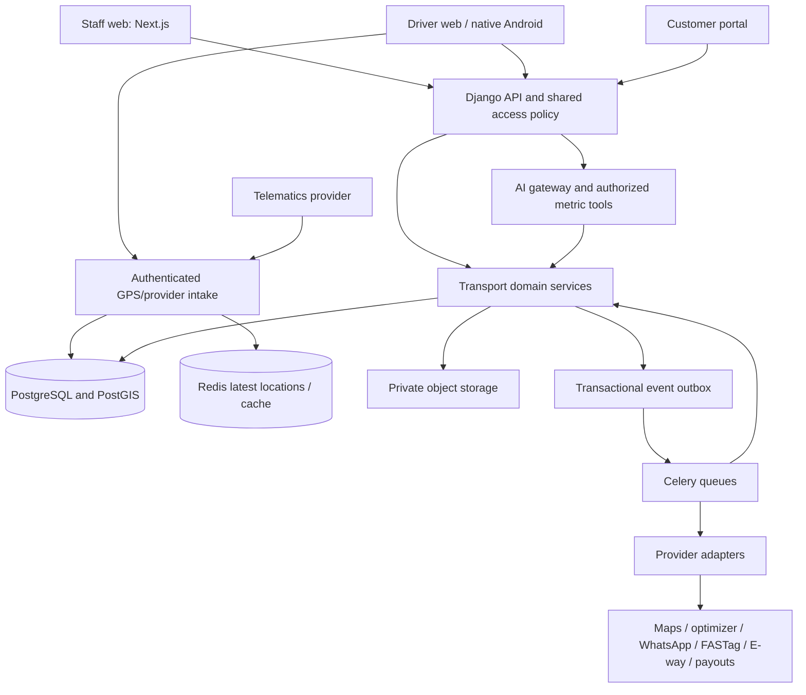

# KriyoPay transport platform architecture

Date: 31 October 2026. Status: proposed build architecture, grounded in the current repository.

Companion: [implementation plan and acceptance backlog](transport-platform-build-plan.md). Current baseline: [code analysis](code-analysis-2026-10-31.md) and [fleet rollout inventory](fleet-client-rollout.md).

## 1. Product direction and architecture decisions

Extend KriyoPay into a transport operations and finance platform using the existing Next.js, Django, PostgreSQL, Redis and Celery foundation. Keep a modular monolith with independently scalable workers. A separate microservice fleet would introduce deployment and consistency costs before current traffic establishes a need.

The complete target includes fleet tracking; dispatch and multi-stop planning; fuel, toll and maintenance; transport billing; driver operations; customer accounts/POD; AI assistance; Indian transport integrations; and later warehouse and load-marketplace modules.

Initial assumptions: Indian road freight, INR and Asia/Kolkata defaults, multiple companies/branches, owned and hired trucks, dispatcher-reviewed recommendations. Currency and timezone remain explicit on financial/scheduling records. Branch consolidation and access rules must support later expansion.

Decisions:

1. Preserve existing IDs, API contracts and financial records. Add modules incrementally behind tenant feature flags.
2. Separate operational facts, recommendations and approved financial entries. An AI suggestion or GPS event cannot directly issue an invoice or move money.
3. Use PostgreSQL as the source of truth; Redis stores disposable projections/counters. Durable events and history survive cache loss.
4. Introduce geospatial support through PostGIS after deployment compatibility is verified. Partition high-volume location history; do not put location trails in trip JSON.
5. Keep supplier payables, customer receivables, driver settlements and platform subscription billing as separate ledgers. Consolidated finance reports combine projections without merging obligations.
6. Reuse existing Google Routes and WhatsApp adapter foundations. Routing, optimization, map display, telematics, tolls and government document APIs remain independently replaceable integrations.
7. Start dispatch automation with scored proposals and human confirmation. Enable bounded automatic assignment only after conflict checks, policy controls and pilot evidence pass.
8. Use a mobile web driver experience for the first pilot. Reliable background GPS is a separate native Android delivery with offline sync; hardware trackers feed the same ingestion contract.

## 2. Current capability versus target

“Foundation” means code exists; it does not certify live provider activation or production acceptance.

| Requested capability | Current foundation | Target work |
| --- | --- | --- |
| Live map | Latest phone GPS, refresh view and map link | Embedded fleet map, clustering, freshness, assigned-route overlays |
| Route history/playback | Latest fix only; `FleetTripLocation` is one-to-one | Durable location samples, timeline/playback and exports |
| Geofencing | Dock/location workflows | Factory/customer/warehouse circles and polygons; entry/exit/dwell events |
| Deviation, ETA, idle/stop | Conditional traffic ETA and basic stop/deviation signals | Persistent episodes, route versions, ignition-aware idle, planned-stop exemptions |
| Driver/truck assignment | Manual dispatch, capacity checks and assignment locks on creation | Availability calendar, proposals, atomic confirmation and opt-in automation |
| Multi-stop / optimization | Order-to-trip relation, lane history, traffic route lookup | Shipments, manifests, stops/legs, optimizer and unserved-order explanations |
| Return loads | Suggestions, offers, reviewed booking and cancellation | Integrate planning horizon and optional external load feeds |
| Fuel / toll / claims | Trip expense categories, litres, receipts and review | Fill-to-fill ledger, station/card inputs, FASTag imports, stronger evidence and exception handling |
| Maintenance / vehicle health | Service, breakdown, return-to-service, expiry and due odometer fields | Work orders, service schedules, tyre lifecycle, odometer reconciliation, health snapshots |
| Billing / P&L | Customer invoices/collections, trip revenue/cost, driver pay/advances | Rate cards, draft automation, tax snapshots, invoice lines, hired-carrier obligations, full cost views |
| Customer login / tracking | Revocable shipment links, milestones, limited POD/invoice downloads | Customer identities, customer-scoped accounts, shipment map visibility controls, disputes |
| Signature / photos / e-POD | Delivery proof document and recipient name | Actual signature strokes/image, multiple photos, structured POD and versioned downloadable PDF |
| WhatsApp | Consent, notice outbox/status and callbacks | Provider activation, approved templates, customer preferences and delivery monitoring |
| AI assistant / insights | Reporting and contextual anomaly rules | Authorized metric tools, grounded answers and saved insight cards |
| Predictive maintenance | Historical reliability signals | Rules first, calibrated risk models only with sufficient representative data |
| Intelligent documents | Reviewed extraction for invoice/logistics files | Typed LR/GR/fuel/POD/challan schemas, source field evidence and reconciliation |
| E-way bill / LR / GR / challans | E-way/consignment document upload and review | Lifecycle records, numbering, expiry/actions, provider verification and penalties |
| Multi-branch | Directory/assignments; most scoped actions blocked | Enforced branch ownership and authorized cross-branch workflows |
| Regional languages | English UI | English/Hindi/Marathi pilot, translated messages and mobile workflows |
| UPI settlements | Recorded driver payments | Payment-provider adapter, payee validation, approvals and verified outcomes |
| Driver KYC / attendance | Driver identity, user link and status | Restricted KYC/licence records, shifts, attendance, leave and fair performance metrics |
| Warehouse | No dedicated stock ledger | Independent receiving, stock, loading, unloading and dispatch integration |
| Load marketplace | Internal return-load matching only | Separate opt-in network, load offers, carrier verification, booking/disputes |
| Cash flow / wider finance | AP, AR, reconciliation and operational reports | Due-date forecasts, working capital and reconciled profitability projections |

## 3. System structure

Use logical domains within the existing `backend/fleet` app first. Proposed packages: `tracking`, `dispatch`, `fuel`, `maintenance`, `billing`, `delivery`, `drivers`, `insights`, and `integrations`. Each has thin views, typed serializers, tenant-scoped selectors, transactional services and tests. Keep legacy URL imports working while moving behavior out of the 2,601-line `views.py` file. Extract a separate Django app only when ownership and migration dependencies justify it.

Existing `fleet/models.py` can remain a facade while models move carefully into a package. Preserve Django model identities and migration state. Do not create duplicate Vehicle, Driver, Customer, Trip, Invoice or Document masters.

Separate Celery queues for ingestion/alerts, provider I/O, documents/AI, finance and periodic reporting. Apply bounded jobs, rate limits, retries and dead-letter review. User requests should not wait for provider bulk work. Start live views with authenticated incremental polling; adopt SSE/WebSockets only when measured concurrency justifies the deployment change.

## 4. Cross-cutting access, events and consistency

Every business query receives a server-resolved tenant context plus permitted branch/customer/driver scope. Never accept tenant authority from request bodies or model-generated filters. Reuse the same lifecycle and feature policies for JWTs, API keys, signed public links, provider credentials and workers.

Roles are capabilities: owner, finance, dispatcher/fleet, approver, store, driver, auditor, customer contact and integration credential. A customer contact belongs to an explicitly scoped customer relationship within a tenant; ordinary tenant membership must not give that contact access to the internal workspace. A driver sees assigned trips and their own claims/pay records. Provider credentials may ingest only mapped devices/accounts.

For branch scope, add a business-record owning branch and explicit shared/global-master rules. Trips transferring between branches record ownership and authorized handover; do not silently broaden access through joins. Owners can have an explicit consolidated view. Customer users see only customer-authorized branches/shipments. Global customer/vendor masters need branch visibility mappings rather than inferred access.

Every command carries a request/idempotency key and expected revision where appropriate. Lock related resources in a documented order; atomically validate assignment, balance and status before changing them. A replay with a different payload is a conflict. Persist audit and outbox events in the business transaction, enqueue after commit, claim deliveries atomically and deduplicate consumers. Do not call external providers while holding financial/dispatch locks.

Event envelope: `event_id`, `tenant_id`, `branch_id`, `aggregate_type/id`, `aggregate_version`, `event_type`, `occurred_at`, `schema_version`, `correlation_id`, and bounded payload. Example events: location.accepted, geofence.entered, trip.dispatched, stop.completed, pod.reviewed, trip.approved, transport_invoice.drafted, payout.outcome_observed. Names are proposed contracts.

## 5. Data model additions

All additions use tenant ownership, UUID identity, actor/time metadata, constrained states and explicit provenance. Financial amounts use Decimal; GPS values, distances and fuel quantities retain suitable precision and units. Unique keys include tenant/provider scope. Same-tenant foreign-key rules are enforced by services and database constraints where practical.

| Domain | Proposed records and relationships |
| --- | --- |
| Tracking | `TrackingDevice`, `DeviceAssignment` effective periods, append-only `LocationSample`, `Geofence`, `GeofenceVersion`, `GeofenceState`, `TrackingEpisode`, `RouteSnapshot`, `EtaObservation` |
| Dispatch | `Shipment` linked to legacy TransportOrder; `TripManifestItem`; ordered `TripStop`; `TripLeg`; `ResourceReservation`; `DriverShift`, `DriverLeave`; `DispatchPlan`, `OptimizationRun`, `AssignmentProposal` |
| Fuel/tolls | `FuelFill`, `FuelCardTransaction`, `FuelReconciliation`, `TollTransaction`, `ExpenseClaim`, import batches/rows and evidence links to existing `TripExpenseLine` |
| Maintenance | `OdometerReading`, `ServiceSchedule`, `MaintenanceWorkOrder`, `MaintenanceTask`, `Tyre`, `TyreFitment`, `VehicleHealthSnapshot`; extend existing maintenance records rather than replacing history |
| Commercial | Effective-dated `FreightRateCard`, `RateRule`, `FreightQuoteSnapshot`, `TransportInvoiceLine`, `TaxSnapshot`, `CarrierContract`, `CarrierPayable`; reuse customer collections and supplier-payment services where liability ownership matches |
| Delivery/customer | `CustomerContactMembership`, scoped login/invitations, `POD`, `PODEvidence`, `DeliveryAttempt`, `CustomerPreference`, `CustomerDispute`; retain revocable links as a restricted alternative |
| Driver | `DriverCredential`, `CredentialVerification`, `AttendanceEvent`, `ShiftAssignment`, performance projections; reuse salary, earnings, advances and recovery records |
| Compliance/integrations | `TransportConsignment`, `Challan`, `ComplianceDocumentLifecycle`, `ProviderConnection`, `ProviderEvent`, `SyncCursor`, `PayoutAttempt`; typed references to private documents |
| Intelligence | `MetricDefinition`, `InsightRun`, `InsightEvidence`, `AssistantConversation`, `AssistantToolAudit`, `PredictionRun`, `ModelVersion`, evaluation results |
| Later extensions | Warehouse/stock movement and marketplace load/offer/booking models live in their own bounded apps |

### Critical schema evolution: order, trip and invoice cardinality

Today `TransportOrder` has one linked trip and `TransportInvoice` has one-to-one order/trip links. Multi-stop and consolidated billing require explicit change before building a planner.

Introduce Shipment and manifest/stop records additively. Backfill one shipment and its pickup/delivery stops for every legacy order/trip. Keep original links for compatibility during migration. Use manifests to support multiple shipments per trip and later split shipments across trips with quantity/capacity accounting.

Invoice allocations must link charge lines to shipments/trips, allow several trips in one invoice and prevent the same approved charge being billed twice. Retain legacy one-to-one fields until consumers migrate; then relax/remove them through a reviewed data migration. Issued invoice numbers, totals, evidence and past collections remain unchanged. Historical documents use their original snapshots.

## 6. Tracking pipeline and detection rules

Ingestion authenticates a driver/device/provider, resolves the effective vehicle/trip assignment, validates coordinates/time/accuracy, deduplicates source events and writes accepted samples. Record captured time separately from receipt time. Late offline samples may enrich history but cannot move the latest projection backwards or resend old customer alerts.

Maintain the existing latest-location API/projection while adding history. Store raw event lineage and validation status; keep impossible jumps or poor-accuracy samples out of ETA/geofence calculations. Expose a GPS-derived stopped state separately from engine idle. Engine idle requires ignition/engine telemetry; absent that evidence, label the signal “stationary”.

Geofences have versioned geometry, site type, time rules, dwell threshold and allowed stop purpose. Use spatial indexes, boundary hysteresis and consecutive good fixes to avoid noisy entry/exit events. Deviation compares to an approved route corridor, with uncertainty buffers and scheduled-stop exemptions. Episodes have start/end/evidence/policy version and review state. A cache restart reconstructs state from durable checkpoints.

Playback provides bounded date windows, chronological samples, simplified polylines and stop markers. Never fetch an entire fleet's raw history into one browser response. Show data gaps and provider freshness; do not interpolate gaps as observed travel. Customer map access is an explicit visibility policy, normally shipment milestones/ETA, with optional coarse position and no driver personal details.

Sizing assumption: 1,000 vehicles transmitting every 30 seconds for 12 hours produce 1.44 million points/day and approximately 130 million points in 90 days before indexes/replicas. This arithmetic is a design scenario, not observed traffic. Pilot default: 90-day raw history, configurable shorter retention, daily/monthly partitions selected after load tests, older aggregates where justified. Quote storage and provider costs from measured usage before general release.

## 7. Planning and dispatch

A planning request snapshots orders/shipments, stops, addresses/coordinates, load units, vehicle capacities/types, driver shifts/leave, documents, maintenance blocks and current reservations. Optimization must respect pickup-before-delivery, load at every leg, time windows, service durations, work/break policy and unavailable resources. Return loads are candidates within the same capacity/time model.

Compute hard feasibility first, then rank cost, distance, expected tolls, lateness penalties and utilization using configurable weights. A feasible heuristic is the initial fallback; a provider solver is an adapter. Preserve unknown toll/traffic/restriction values as unknown and show unserved shipments with reasons. A passenger-car road route is not a guarantee of truck access; provider truck restrictions must be verified or reviewed explicitly.

Proposal states: QUEUED → RUNNING → PROPOSED → REVIEWED → CONFIRMED or EXPIRED/FAILED. Persist input and policy fingerprints, provider version, route metrics and exclusions. Confirmation locks all assigned resources, rechecks availability/revision and creates reservations/trips/stops atomically. Expired proposals cannot dispatch. Bounded auto-confirm later uses explicit tenant policy and the identical command.

## 8. Expense, maintenance and finance rules

Fuel fills capture vehicle, optional trip, odometer, litres, price, station, full/partial tank flag, source transaction and evidence. Compute fill-to-fill efficiency only for valid complete intervals; purchase litres do not establish fuel consumed during one trip. Keep existing trip litres/km as a labelled spending/intake comparison. Reconcile fuel-card/toll imports into draft expenses, preserving unmatched, duplicate, reversed and corrected transactions. Fuel loss/theft remains a review hypothesis unless independently confirmed.

Maintain an odometer evidence chain from manual readings, trip readings and telemetry, with reviewed corrections. Service reminders use trustworthy current mileage and dates. Tyres have serials, position changes, fitment/removal mileage, repairs and disposal. Work orders separate estimated, approved and actual costs. Avoid counting one repair both as a trip cost and as an additional maintenance expense in consolidated P&L.

Rates are effective-dated by customer, lane, vehicle type, quantity/unit, distance, minimum charge, detention and surcharges. A completed eligible trip produces a draft invoice using an immutable rate/calculation snapshot. Tax rules and required invoice fields are versioned and approved by the operator's accountant before activation; “GST-ready” does not imply government filing/verification. Issue remains an authorized financial action. Document records and provider acknowledgments have separate statuses.

Show contribution margin and fully allocated profit separately. Contribution margin uses approved freight minus directly attributable approved expenses; full-cost profit additionally uses documented allocation policies for driver earnings, tyres, maintenance, hired-carrier charges and overhead. Forecast receivables from due dates and observed payment patterns; label forecasts and unverified collections clearly.

Driver payout flow: reviewed settlement → authorized payment intent → provider request → accepted/unknown/failed → independently verified outcome → posted payment/reconciliation. Preserve the same provider intent key after timeout; never retry an unknown outcome as a new payment. A recorded UPI reference alone is not verified settlement. A driver's payment address and any changes require controlled verification.

## 9. Driver and customer experience

Driver mobile screens: today's work, ordered stops, start/arrive/load/deliver, receipt claim, advance/settlement, POD capture, emergency/breakdown and language choice. Offline mutations have stable event IDs, encrypted device storage where supported and revision/conflict resolution. GPS tracking is explicit during authorized work; native background operation must be tested on representative Android devices and low-connectivity routes.

KYC/licence documents have restricted visibility, verification source/date, expiry, renewal and deletion/retention policy. Attendance can use shift check-in/out with location consent; GPS alone is insufficient evidence of attendance or misconduct. Delay performance compares planned and actual delivery with route/customer/load context and an operator correction path.

Customer accounts see only their shipments, invoices, collections and disputes. POD includes recipient, captured signature, photos, capture/receipt timestamps, optional authorized coordinates, document hash/version and review status. Treat a captured signature as delivery evidence rather than certified identity. Reattempts and rejected POD preserve history. Downloadable PDFs use authorized streaming or short-lived signed URLs. WhatsApp events use recorded consent, recipient preferences, template versions, deduplication and delivery callbacks.

Internationalize new UI copy and server notification templates from the start. Pilot English/Hindi/Marathi, translated validation, locale dates/numbers and low-literacy mobile labels; preserve original document text and registration identifiers. Do not translate financial identifiers or machine enum values.

## 10. AI and analytics architecture

Start with an authorized metric/query layer that is useful without an LLM. Metrics include truck contribution/full-cost profit, fuel interval efficiency, delay distribution, utilization, route margin, outstanding ageing and cost anomalies. Every answer includes period/timezone, metric definition, data completeness, evidence links and calculation time.

The assistant interprets a question into an allowlisted tool call, validates arguments and authorization on the server, executes scoped selectors, and summarizes their results. No unrestricted SQL, arbitrary code execution, model-selected tenant identity or financial mutation tools. Example tools: `truck_profitability`, `fuel_anomalies`, `driver_delivery_delays`, `route_margin`, `customer_overdue`. The model sees the minimum required data and cannot override row/branch permissions. Document/portal text is untrusted input, never tool instructions.

OCR extracts typed candidate fields from LR/GR, invoice, fuel receipt, e-way/POD and challan documents. Save provider/model/schema version, confidence, page/field evidence where available, source checksum and human edits. Validate totals, dates, units and vehicle/customer links; prevent silent financial posting. Exclude KYC documents from general AI processing by default.

Predictive maintenance progresses from due-date/mileage rules, to contextual risk scoring, to a calibrated model when data quality and failure labels justify it. Use vehicle/lane/time-separated evaluations, compare to the simple baseline and report coverage, false positives and useful warning lead time. Sparse data returns “insufficient history”. Models never cancel trips or authorize repairs automatically.

Business insights are scheduled evidence-backed findings, deduplicated by source/policy version, with acknowledge/dismiss/resolve feedback. Track token/provider budget per tenant, consent, redaction, model latency and output evaluations. Route optimization uses a constraint solver/routing data; the LLM explains the plan and handles questions.

## 11. Proposed API and UI surface

Paths below are additions/contract sketches under `/api/v1/fleet`, subject to API design review. Preserve existing routes as adapters.

| Capability | API sketches | UI |
| --- | --- | --- |
| Tracking | `POST /tracking/events`, `GET /tracking/vehicles`, `GET /trips/{id}/track?from=&to=&cursor=` | Extend live-tracking; playback drawer |
| Geofences | `/geofences`, `/geofence-events`, `/tracking-episodes` | Sites/geofences and alert review |
| Planning | `/shipments`, `/dispatch-plans`, `POST /dispatch-plans/{id}/optimize`, `/assignment-proposals/{id}/confirm` | Dispatch calendar, planning map and proposal review |
| Availability | `/driver-shifts`, `/driver-leave`, `/resource-reservations` | Availability board |
| Fuel/tolls | `/fuel-fills`, `/fuel-reconciliations`, `/toll-imports`, `/expense-claims` | Fuel ledger, toll inbox, claims |
| Maintenance | `/service-schedules`, `/work-orders`, `/tyres`, `/odometer-readings` | Service planner, tyre history, health |
| Billing | `/rate-cards`, `/freight-quotes`, `/invoice-drafts`, `/carrier-payables` | Rate setup, invoice review, transport finance |
| Customer/POD | Customer-scoped `/customer/shipments`, `/customer/invoices`; `/trips/{id}/pods` | Separate portal, mobile POD capture |
| Driver | `/driver-credentials`, `/attendance`, `/payout-intents` | Restricted driver admin, mobile personal finance |
| Intelligence | `/insights`, `/assistant/queries`, `/maintenance-risks` | Fleet assistant panel and insight cards |
| Compliance | `/consignments`, `/challans`, `/compliance-documents`, `/provider-connections` | LR/GR, compliance and integrations |

History/list endpoints use bounded server pagination and filters. Optimization, import, PDF and AI jobs return job IDs/status, with cancellation where meaningful. Downloads recheck authorization. Actions expose explicit conflicts and never treat retries as fresh financial instructions.

## 12. Integrations and independent expansion modules

| Integration/module | First usable delivery | Activation and next step |
| --- | --- | --- |
| Maps/traffic/optimizer | Existing Routes plus map and proposal adapter | Separate map-display/optimization entitlement, credentials, quotas and truck-route suitability evaluation |
| GPS trackers | Generic signed canonical event API, device-to-vehicle mapping and 24-hour late-event replay | Chosen provider protocol adapter, clock/event-ID verification, fixture replay, authorization review and offline replay certification |
| FASTag | CSV/statement import with evidence/review | Authorized issuer/aggregator account, vehicle/tag mapping, reversals, backfill and deduplication contract |
| E-way bill | Reviewed document metadata and validity reminders | Verify current access eligibility and provider authorization, sandbox generation/update/cancel/reconcile before enabling actions |
| LR/GR/challans | Consignment numbering, documents and penalty review | Provider connectors only where accessible and authorized; penalties remain reviewed liabilities |
| WhatsApp | Existing outbox, template/consent/status foundation | Account/template activation and designated-recipient acceptance tests |
| UPI/payouts | Approved intent and manual evidence workflow | Payout-enabled provider agreement, beneficiary verification, callbacks and settlement reconciliation |
| Warehouse | Separate `warehouse` app: location/bin, receipt, stock movement, loading/unloading | Immutable stock movement ledger, transfers, counts, reservations and shipment handovers; financial inventory valuation is a separately scoped increment |
| Marketplace | Separate `marketplace` app: published load, carrier profile, offer and booking | Explicit opt-in publication, carrier verification, visibility/redaction, cancellation/dispute policy and anti-abuse controls; internal tenant data never becomes public automatically |
| Broader finance | Cross-ledger read projections | Cash forecast, AP/AR ageing, overhead allocation and ERP exports; ledger ownership remains unchanged |

Treat warehouse and marketplace as independent products with their own acceptance gates after core fleet adoption. Driver management and finance foundations are part of the core build.

## 13. Operations, rollout and measurable targets

Separate staging and production, managed private storage/backups, secret rotation, HTTPS, staff session MFA and queue monitoring. Export metrics for location age/ingestion lag, provider failures, stale tracking, plan duration, outbox depth, invoice exceptions, payout unknown outcomes, AI cost and cross-scope denials. Add correlation IDs across request, event and provider attempt.

Proposed pilot targets, to validate with load tests: 100 active vehicles; 95% of accepted online GPS samples visible within 15 seconds of receipt; non-provider paginated API reads p95 under 800 ms; latest-map refresh under 3 seconds for a 100-vehicle view; zero duplicate posted financial entries under replay/concurrency tests. Offline delivery and provider delay are reported separately. Scale testing should include the 1,000-vehicle scenario before onboarding at that size.

Roll out by company/branch with explicit flags and reversible UI/API routing. Disable new actions on rollback while retaining accepted events, issued invoices and audit history. Use additive schema changes, backfill verification and reconciliation reports before contract removal. Verify backup restore and tracking retention deletion in staging.

## 14. Source and verification notes

Current-state claims come from `backend/fleet/models.py`, `urls.py`, `views.py`, `serializers.py`, `routing.py`, `anomalies.py`, `shipment_portal.py`, `customer_notifications.py`, the repository review and rollout documents. Existing code remains the source of truth where older design documents differ.

Google's official overview supports fleet task/route optimization with supplied time/capacity/working-hour constraints and cost objectives. This establishes an adapter candidate, not a provider procurement or truck-routing certification: [Route Optimization overview](https://developers.google.com/maps/documentation/route-optimization/overview).

Official e-way API references were located, but detailed page retrieval failed during planning. Current eligibility, supported actions and onboarding requirements remain an explicit integration discovery task: [GSTN e-way API portal](https://docs.ewaybillgst.gov.in/apidocs/index.html). No claim of open API access or current regulatory rules is made here.

The supplied image links are feature inspiration. They do not establish API access or implementation specifications. Other providers, prices, legal/tax settings and mobile platform requirements must be verified during their integration phase.
