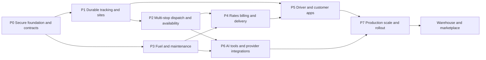

# KriyoPay transport platform build plan

Date: 5 November 2026. Status: implementation in progress; progress below reflects the current workspace.

Architecture: [transport-platform-architecture.md](transport-platform-architecture.md). Baseline risks: [code-analysis-2026-10-31.md](code-analysis-2026-10-31.md).

## Product-suite scope: Kriyo products 8–15

The pasted product vision is the target scope for the transport suite. These are connected product modules sharing company, vehicle, shipment, document and financial records; they are not eight unrelated application rewrites. Delivery remains phased: finish and validate the internal operating system first, then add network-facing marketplace and integration products after their access, trust and commercial rules are ready.

| Product | Scope in the supplied vision | Current workspace coverage | Remaining work / delivery gate |
| --- | --- | --- | --- |
| **8. KriyoFleet** | Fleet operations, live tracking, drivers, trip performance, maintenance, costs and profitability | Fleet dashboard, trips, phone GPS history/playback, geofences, route exceptions, ETA foundation, driver records, maintenance, fuel, expenses, customer deliveries and operational reporting | Close Phase 0/2/3/4/5/7 gates; provider-certified tracking and background mobile app, full maintenance/tyre lifecycle, branch ownership, and reconciled profitability remain staged work |
| **9. KriyoLoad** | Shipper/transporter marketplace: verified network, published loads, matching, offers, booking and disputes | Internal return-load suggestions and offers within one fleet workspace | Build the separately permissioned multi-company network, verification, opt-in publication, search/matching, negotiation, atomic booking, dispute/trust operations and commercial reconciliation (MKT-01–06) |
| **10. KriyoFreight** | TMS for bookings, allocation, rates, lifecycle, LR/e-way documents, freight billing, POD and reports | Transport orders, trip/stop planning, customer and transporter records, document workflows, freight reconciliation, customer invoices/collections and reports | Rate cards/quote snapshots, consolidated automated invoice drafts, reviewed GST structure, complete LR/e-way/challan lifecycle, and finance/branch acceptance (FIN-01–06, BRN-03) |
| **11. KriyoControl** | Control tower for multi-carrier visibility, ETA/delay prediction, exceptions, summaries and escalations | Unified internal trip/live tracking views, ETA history, route/deviation/dwell exceptions, exception center and notification workflows | Multi-transporter ingestion, evidence-backed delay prediction, action recommendations, configurable escalation, cross-carrier scorecards and verified summaries (TRK, AI-01–04, INT-01/02) |
| **12. KriyoRoute** | Constrained multi-stop routing and dynamic dispatch optimized for total delivery cost | Operator-confirmed multi-stop planning, availability checks, bounded assignment search, Google Routes adapter and explicit fallback | Validate real provider account and pilot constraints; add robust traffic/toll/vehicle constraints, dynamic reassignment and cost-per-completed-delivery objective as data/providers permit (DSP-01–06) |
| **13. KriyoFuel** | Vendor-neutral fuel/energy ledger, efficiency, reconciliation, anomalies and cost forecasting | Fill ledger, CSV staging/reconciliation/refunds, budgets, alerts, per-vehicle trends, and measured loaded/empty km/L when data coverage supports it | Authorized fuel-card/FASTag/GPS/telematics feeds, driver-wise attribution quality, EV charging/battery data, validated anomaly baselines and forecasting (EXP-01/02/04, INT-01) |
| **14. KriyoProof** | Verifiable delivery evidence linked to disputes, invoices and payment workflows | Trip delivery status/proof fields, shipment portal, logistics documents and existing audit/event foundations | OTP verification, multiple photo/video/signature/quantity evidence, GPS/time verification, versioned downloadable e-POD, correction/dispute workflow and finance linkage (POD-01/02, APP-01/02/05) |
| **15. KriyoConnect** | Logistics integration layer: normalized APIs/events, GPS/payment/document connectors, webhooks and developer sandbox | Internal REST APIs, selected GPS intake, payment/ERP/Gmail integrations, and outbound webhook delivery foundations | Productized API keys/scopes, stable public shipment/GPS/payment/document contracts, event subscriptions, replayable sandbox, rate limits, connector monitoring and developer documentation; expand only with integration ownership and SLAs defined |

### Cross-product delivery order

1. **Operational foundation and pilot readiness:** complete the shared access/event/branch contracts and validate real phone-plus-tracker data (Phase 0, Phase 1).
2. **Fleet execution:** finish constrained planning and dispatch, fuel/maintenance/driver workflows, then commercial billing and proof-of-delivery (Phases 2–4).
3. **Operator and customer experience:** customer accounts, notifications, Android driver workflows and language support (Phase 5).
4. **Intelligence and integrations:** deterministic metrics first, then reviewed assistant/insight features and authorized provider connectors (Phase 6).
5. **Scale and network products:** production acceptance (Phase 7), followed by invitation-only KriyoLoad and the productized KriyoConnect layer. Warehouse remains a separate expansion module, not a prerequisite for products 8–15.

This map is a product target, not a claim that each product is production complete. Existing internal capabilities are not equivalent to third-party provider activation, a native mobile application, an open marketplace, certified financial/tax compliance, or validated predictive models.

## 1. Delivery assumptions and release order

Build on the current application. Deliver working operational slices with migrations, API, UI, permissions, audit, tests and pilot instructions together. Do not rebuild existing expense, salary, shipment-link, collection or document workflows under new names.

Planning team assumption: two backend engineers, one frontend engineer, one mobile engineer and one QA/automation engineer, with shared product/design and infrastructure support. Estimates are elapsed ranges for this team, with domain work overlapping only where dependencies allow. They are planning estimates, not commitments; revise after Phase 0 and provider discovery. Provider approvals, account access, data collection and field trials can extend calendar time independently.

- First usable pilot: tracking history, embedded map, fuel/expense improvements and secure existing workflows in approximately 10–14 weeks, using foreground phone GPS.
- Core advanced transport platform: approximately 32–44 weeks including dispatch, maintenance, billing, customer/driver workflows, native tracking, intelligence foundations and production acceptance. Scoped provider integrations may land progressively.
- Full vision including mature predictions, comprehensive warehouse and public marketplace: plan roughly 12–18 months total, with separate product discovery and estimates. Training-data readiness can push predictive models later.

These ranges assume the stated team. A single developer should re-estimate by person-effort rather than adopt the team calendar. No API subscription, hardware or cloud costs are included. Select representative pilot operators and collect sample documents/routes before detailed development.

## 2. Dependency sequence

Native tracking discovery starts during P0; implementation starts alongside P1 after the event contract is stable. AI metric work can start as domains become reliable. Paid/live connectors require credentials and explicit activation but do not block manual/import workflows.

## 3. Phase 0 — establish the safe foundation

Estimate: 2–4 weeks. Owners: backend lead, QA, infrastructure.

| ID | Deliverable | Done when |
| --- | --- | --- |
| FND-01 | Fix account-wide MFA freshness and unify staff token policy | Password-only JWT cannot access MFA-protected staff APIs; independent sessions and refresh tested |
| FND-02 | Shared lifecycle/access policy for JWT, keys, public links and workers | Deleted/suspended tenants and branch-scoped actors have consistent behavior across entry points |
| FND-03 | Repair configuration mutations and test contracts | Single/bulk overrides work, actor/audit correct, no misleading success; valid fixtures satisfy security policy |
| FND-04 | Central quota checks, last-owner protection, dispatch/export locks, webhook claims | PostgreSQL concurrency/replay checks pass and findings have regression coverage |
| FND-05 | Define branch policy and resource ownership | Directory/global-master rules, handovers and consolidated access documented and tested |
| FND-06 | Queue/outbox and command conventions | Event/idempotency/revision/error contracts adopted; provider I/O outside DB locks |
| FND-07 | Staging baseline and CI | Backend suite green or each obsolete test corrected with rationale; frontend build/typecheck/tests pass; PostgreSQL integration suite runs in CI |
| FND-08 | Provider/data discovery | Sample GPS/fuel/toll/LR/POD data collected, Google/Meta readiness rechecked, API account owners and blockers recorded |

Progress: FND-01 through FND-06 have implementation, policy, and regression coverage in this workspace. FND-02's shared workspace lifecycle policy governs normal memberships, API keys, vendor/shipment links, intake tokens, ERP/Gmail/fleet/background jobs and outbound webhooks. Branch-scoped memberships are rejected at entry points that cannot enforce branch filtering. Regressions cover existing API keys, vendor links and invoice intake after suspension, branch-scope enablement and deletion. FND-04 centralizes invoice quota enforcement in the model creation path under a tenant lock (including intake workers and explicit zero overrides); protects the last active owner in role edits and invitation acceptance; locks trip resources before reassignment checks; re-reads and locks invoices before Tally export; and atomically claims webhook deliveries with stale-claim recovery. PostgreSQL regressions cover concurrent invoice quota intake, owner protection, dispatch reassignment, stale export replay and concurrent webhook workers. FND-05 documents branch-owned records, global masters, consolidated access, fail-closed endpoints, and handover rules in `docs/branch-ownership-policy.md`; branch assignments enforce same-workspace ownership and tests cover branch assignment isolation and denied workspace-wide access for scoped members. Owning-branch fields, mappings and handover workflows are the later BRN-01 through BRN-03 implementation. FND-06's `docs/job-and-event-contracts.md` defines durable outbox, idempotency, revision, claim/fencing, retry, provider-I/O, and bounded command rules. Razorpay webhook work uses a persisted claim token/lease and performs `order.paid` verification outside the claim transaction. Gmail message intake uses leased idempotent claims with stale-claim recovery and token-fenced writes. Customer notices use persisted unique deliveries, a provider-outside-lock claim, and scheduled recovery. The webhook delivery command now supports a bounded dry run. Focused PostgreSQL worker, replay, and command regressions pass. FND-07's CI workflow runs PostgreSQL 18 checks and the production frontend build. Local CI-equivalent checks on 5 November 2026 passed: Django system check; all 313 backend tests against local PostgreSQL; all 27 frontend tests; frontend lint and typecheck; and the Next.js production build. Migration `0044` for optional tracker ignition evidence was applied locally. Lint reports one pre-existing `` optimization warning in `admin-mfa/page.tsx`. The GitHub Actions runner result remains unverified because this checkout has no authenticated GitHub CLI session. FND-08 remains open for the selected phone-plus-tracker pilot: the operator confirmed no tracker vendor/model has been selected yet; `docs/provider-data-discovery.md` records the requested samples and current blockers. Real Google Routes/WhatsApp, FASTag, fuel-card, and E-Way Bill readiness also remains unverified. Phase 0's code-owned checks are complete; the phase is not release-complete until remote CI evidence and the named provider/sample-data gates are closed.

Gate: resolve the high-risk audit findings before enabling new customer/provider access. Do not weaken MFA merely to make fixtures pass. The earlier 20-failure baseline is superseded by the latest full PostgreSQL run (302 passed); keep that suite green in CI.

## 4. Phase 1 — advanced tracking and geofences

Estimate: 4–6 weeks after foundation contracts. Owners: backend, frontend, mobile, QA.

| ID | Deliverable | Done when |
| --- | --- | --- |
| TRK-01 | Append-only GPS samples plus latest projection | Duplicate event is a replay; late sample enriches history without regressing latest state; bad fixes are marked/excluded |
| TRK-02 | Fleet map and trip playback | Map displays freshness, active assignment, route and history; playback handles gaps and bounded windows |
| TRK-03 | Factory/warehouse/customer site geofences | Authorized user edits versioned circles/polygons; boundary noise does not flood events |
| TRK-04 | Persistent arrival/departure/dwell/deviation/stationary episodes | Thresholds, exemptions, evidence, acknowledgements and escalation are reproducible; engine idle shown only with ignition evidence |
| TRK-05 | ETA history and provider budget controls | ETA includes source/freshness; absent data stays unknown; timeout/quota failure does not interrupt GPS intake |
| TRK-06 | Provider device adapter and tracking retention | Signed/authorized sample feed maps to effective assignments; retention job and restore tested |
| BRN-01 | Branch ownership migration and scope primitives | Records have verified owning branches or explicit global visibility; ambiguous historical ownership enters review rather than guessed assignment |

Progress: TRK-01 is implemented for phone GPS: GPS samples are retained in an append-only table, existing latest fixes are backfilled, duplicate event IDs are idempotent, and late-but-valid samples enrich history without regressing the latest projection. A tenant/driver-scoped history API supports bounded pages. TRK-02 now has configurable OpenStreetMap-backed playback, start/end markers, point scrubbing, play/pause, zoom, page loading, and date filters; history requests default to 30 days and are capped at 31 days. Playback breaks the route line across gaps longer than two minutes, marks those intervals on the map, and reports a gap when scrubbing resumes. TRK-03 has versioned circle/polygon sites, owner/fleet-only management, tenant-scoped event reads, and arrival/departure detection requiring accurate fixes, two confirmations, and a 30-second confirmation window. Configurable site dwell thresholds create review cases. Geofence management now supports drag-pan/zoom map drawing for circle centres and polygon vertices, plus versioned map-based boundary edits with a required reason. TRK-04 persists stationary, site-dwell, and route-deviation episodes; route deviation checks use versioned persisted provider geometry, require two accurate fixes over 30 seconds, exempt configured sites, and create review cases. Episodes close on movement, route rejoin/update, or GPS gaps. TRK-05 persists routing provider attempts and ETA history, exposes source/freshness through a tenant-scoped endpoint, and bounds provider calls with per-trip throttling, a configurable rolling 24-hour per-workspace budget, and a 15-minute circuit breaker after three consecutive failures. Provider failures remain isolated from GPS intake. TRK-06 includes a generic HMAC-signed device event feed mapping provider/device IDs to vehicles and active trips, idempotent duplicate handling, late-sample retention without latest-state regression, and a daily bounded retention task. Tracker events may include optional ignition evidence. Engine-on stationary time is counted only across adjacent samples that both include ignition-on and low-speed evidence, and is surfaced with the live stop; missing ignition stays unconfirmed. Six PostgreSQL regressions cover signature rejection, device deactivation, event replay, late arrival, retention, ignition-based idle measurement and live API exposure. Provider-specific certification and real fixture replay, production HTTPS/secret provisioning, and staging backup-restore/retention verification remain external release gates. Engine-idle reporting still depends on a tracker that supplies ignition and speed; the pilot vendor is not yet selected. True spatial indexing and branch ownership remain open.

Pilot acceptance: drive two real routes over HTTPS, lose/recover network, cross a geofence boundary, make a planned and unplanned stop, replay data after app restart, and revoke access. Verify no cross-tenant locations appear. Native app testing later adds screen-off/background and battery behavior; foreground web acceptance must not be presented as background tracking certification.

## 5. Phase 2 — planning, availability and smart dispatch

Estimate: 5–7 weeks. Owners: backend, frontend, QA; route provider specialist as needed.

| ID | Deliverable | Done when |
| --- | --- | --- |
| DSP-01 | Shipment/manifest/stop/leg model and migration | Legacy one-order trips remain usable; sample multi-order and split-load cases preserve quantities and evidence |
| DSP-02 | Driver shift/leave and truck availability calendar | Leave, maintenance, reservations and active trips block incompatible assignments |
| DSP-03 | Multi-stop planning board | Pickup/delivery sequence, time windows, dwell and load at every leg visible and validated |
| DSP-04 | Scored assignment proposals | Compatibility, distance, capacity, hours and availability explain each recommendation; unassigned orders show reasons |
| DSP-05 | Route optimization adapter and fallback | Solver/fallback constraints tested; infeasible inputs produce explicit unserved work; quote/cost uncertainty visible |
| DSP-06 | Atomic dispatch and calendar confirmation | Two concurrent dispatchers cannot reserve the same resource; stale proposals conflict; all stops/assignments commit together |
| DSP-07 | Return-load planning in the same horizon | Internal offers retain acceptance/cancellation audit, honor dispatch reservations and driver schedules, and cannot overbook confirmed work |
| BRN-02 | Branch-aware operations and handovers | Dispatch, sites, trips, documents, reservations and transfers enforce actor branch scope; authorized consolidation is explicit |

Acceptance cases: one truck with three stops; two trucks with incompatible capacities; pickup-before-delivery; driver leave; open breakdown; late-window infeasibility; stale plan; simultaneous confirmation; cancelled unstarted booking. Automatic confirmation remains off until an explicit constrained policy and pilot evidence are approved by the product owner.

Progress (2026-11-03): the dispatch planning slice is implemented in this workspace. `FleetTripManifestItem`, `FleetTripStop`, `FleetDriverSchedule`, `FleetResourceReservation`, and persisted expiring `FleetDispatchPlan` proposals support shipment manifests, ordered pickup/delivery stops, schedules, reservations, idempotent confirmation, and stale-order checks. Migration `0036_dispatch_planning` backfills existing one-order trips. Multi-truck proposals now use bounded branch-and-bound across feasible truck groups, maximizing served shipments, then minimizing trips, preferring known shifts, and minimizing straight-line distance. Results expose search work counts and distinguish exhaustive results within the route-feasibility model from best-found results when the 25,000-node limit is reached. Deterministic greedy strategies remain available as proposal fallbacks. Confirmation validates and commits every proposed trip in one transaction, and the UI calls out unassigned shipments and search completion status. Return-load suggestions and booking now check confirmed resource reservations and driver leave/availability schedules over the proposed window; accepted bookings create reservations released on trip completion or cancellation. Missing return-load durations use an explicit 8-hour estimate, capped at 48 hours, and remain subject to dispatcher review. The dispatch planner page also shows route stops and explainable resource scores, records driver shifts/leave/unavailability, and requires operator confirmation. Driver trip UI records ordered stop arrival/completion; order quantities and statuses update across split loads, and trip completion releases reservations. Invoice creation can select a shipment within a multi-order trip while retaining the single-order shortcut.

Road routing is now an opt-in Google Routes adapter using the existing fleet route setting and server-only `GOOGLE_MAPS_ROUTES_API_KEY`. It requests traffic-aware road distance/duration and optimized intermediate stops, then revalidates pickup-before-delivery, truck capacity, and due windows. A short tenant-locked claim applies the shared daily request budget and failure circuit; network I/O runs after that lock is released. Confirmed Google routes save their geometry, ETA, and distance on the trip. Disabled, unconfigured, over-budget, failed, or infeasible provider calls retain the explicit straight-line fallback. Provider requests are limited to three route assignments per plan.

The route fallback is deterministic nearest-neighbor over straight-line coordinates at a configurable planning speed. It enforces capacity, pickup-before-delivery, basic due windows, driver schedules, active trip/reservation conflicts, and open vehicle breakdowns. Neither provider nor fallback certifies truck height/weight restrictions, toll costs, driver hours, or endorsements. The new optimizer is exhaustive only inside its bounded search and deterministic route-feasibility model; it does not prove global road-route optimality. Live credential/staging validation, branch ownership, and production evidence for concurrent confirmation remain open. Therefore Phase 2 is **in progress**, not complete. Branch-scoped users remain denied at endpoints lacking branch filtering. PostgreSQL regressions cover proposal, multi-stop confirmation/lifecycle, incompatible multi-truck assignment, Google route success and fallback, stale-order rejection, driver leave, idempotent replay, and existing fleet operations (22 tests); local production build and typecheck passed before this solver change. A real Google account/key was not available for a live provider smoke test.

## 6. Phase 3 — fuel, expenses, maintenance and driver records

Estimate: 4–6 weeks, partly parallel with Phase 2. Owners: backend, frontend, mobile, QA.

| ID | Deliverable | Done when |
| --- | --- | --- |
| EXP-01 | Fuel fills and interval calculations | Full/partial fills, missing odometer, duplicate receipt and corrections handled; no unsupported consumption claim |
| EXP-02 | Toll/FASTag and fuel-card import review | Provider IDs, duplicate imports, vehicle/tag changes, refunds and unmatched rows preserved; approved expense created exactly once |
| EXP-03 | Mobile expense claims | Offline replay safe, receipt/private access correct, maker-checker and rejection/reimbursement paths complete |
| EXP-04 | Contextual anomaly review | Baseline evidence/sample counts visible; insufficient data gives no fabricated result; dismiss/resolve feedback retained |
| MNT-01 | Odometer chain and service schedules | Conflicting mileage reviewed; due-by-date/km rules and document expiries trigger deduplicated reminders |
| MNT-02 | Maintenance work orders and tyre lifecycle | Approval, repair, fitment/movement, downtime and return-to-service preserve history; dispatch sees availability blocks |
| DRV-01 | Driver KYC/licence/attendance foundations | Restricted documents, expiry, verification and shift correction flow tested; driver sees only personal records |

Progress (2026-11-04): The dedicated fuel workspace records station, unit price, total, full/partial fill, date and odometer as a draft for review; it provides date-filtered reports and CSV export, per-vehicle monthly and per-trip spend budgets, expected km/L targets, and review cases with decision history. Monthly and per-vehicle daily spend run rates compare month-to-date with the previous full month to show where spending is rising or falling. Trips can be explicitly classified as loaded or empty, with shipment-linked trips defaulting to loaded. Empty-versus-loaded km/L and cost/km are calculated only for full-to-full intervals whose recorded trip odometers cover the complete distance and share a single known load state; mixed, unknown and incomplete intervals are reported separately. Fuel-card CSVs use header aliases and a standard template; duplicate references are blocked, unmatched rows remain staged, and credits/refunds require the original transaction reference and same vehicle, net against spend, and do not count as litres or efficiency fills. Corrections preserve before/after evidence and return the entry to draft review. The synthetic demo includes duplicate, unmatched and refund imports, budget overruns, and separate loaded/empty efficiency examples. Consumption alerts remain review prompts, never findings of fuel loss or theft. Real provider authorization and pilot sample validation remain open; maintenance work-order/tyre lifecycle and reminder delivery deduplication are also open.

Pilot acceptance: one month of representative fuel/toll/repair records, mixed full/partial fills, one tyre change and one breakdown. Reconcile totals to source records and ensure costs are not double counted across maintenance, trip expenses and reimbursements.

## 7. Phase 4 — commercial billing, finance and delivery evidence

Estimate: 5–7 weeks. Owners: backend, frontend, mobile, QA and accountant/product owner for tax configuration.

| ID | Deliverable | Done when |
| --- | --- | --- |
| FIN-01 | Customer freight rate cards and quotes | Effective dates, lane/type/unit/distance/minimum/detention rules produce a traceable quote snapshot |
| FIN-02 | Multi-trip invoice lines/allocations | Migrate one-to-one constraints safely; no approved charge billed twice; historical issued documents unchanged |
| FIN-03 | Automatic invoice draft generation | Eligible trip completion/approval produces one draft; replay does not duplicate; issue requires authorized review |
| FIN-04 | GST-ready record structure | Required identity/tax/line/rounding fields and tax policy reviewed for the actual operating model; credit/correction workflow verified |
| FIN-05 | Transporter/vendor obligations and driver settlement extensions | Liability recorded in correct ledger; existing AP/driver controls reused; duplicate reimbursement prevented |
| FIN-06 | P&L, ageing and cash-flow projections | Contribution versus full-cost profit documented; paid/unverified/forecast distinctions preserved; source totals reconcile |
| POD-01 | Signature, delivery photos and POD versions | Multiple evidence items, recipient, timestamps, failed attempt and correction flow; evidence cannot silently complete/approve finance |
| POD-02 | Downloadable e-POD/invoice PDF | Authorized generated documents preserve version/hash; account and link scopes verified |
| BRN-03 | Branch-aware AP, AR and reports | Invoice/vendor visibility, POs, GRNs, payments, customer receivables and exports enforce the agreed ownership/global-master policy, including direct object/download access |

Acceptance: complete a three-stop route, submit mixed delivery evidence, approve expenses, create a consolidated draft, issue it, record partial customer collections, settle driver reimbursement and reconcile the finance report. Include a rejected POD, duplicate event, corrected rate and cancelled draft.

## 8. Phase 5 — customer portal, native driver app and languages

Estimate: 5–7 weeks; native app work overlaps earlier phases. Owners: mobile, frontend, backend, QA, product/design.

| ID | Deliverable | Done when |
| --- | --- | --- |
| APP-01 | Customer account/login | Contact sees only authorized customer shipments/invoices/disputes; revoked access and tenant suspension take effect immediately |
| APP-02 | Customer tracking and preferences | Milestones/ETA/map visibility are configurable; no unrelated location, cost or driver personal data exposed |
| APP-03 | Android work and background tracking | Assigned-stop workflow, offline queue, screen-off/restart/battery/network tests on representative phones; logout ends tracking authority |
| APP-04 | Regional languages | Core driver flows and notifications work in English/Hindi/Marathi with reviewed translations; identifiers remain intact |
| APP-05 | WhatsApp/email notifications | Opt-in, template approval, designated-recipient live test, unsubscribe, deduplication, uncertain send and callbacks verified |
| APP-06 | Driver personal finance and performance | Own advances/settlements visible; attendance/delay explanations and correction paths work |

Acceptance: customer with two contacts, two branches, two separate customers; a driver completes work offline then syncs; test expired login and revoked shipment link; verify native tracking limits and permissions are understandable to the driver.

## 9. Phase 6 — AI differentiation and authorized integrations

Estimate: 5–8 weeks for the assistant, insights, extraction and integration foundations. Provider certifications and trained prediction models may continue afterward. Owners: backend/data engineer, frontend, QA and integration owner.

| ID | Deliverable | Done when |
| --- | --- | --- |
| AI-01 | Versioned metric/query tools | Truck profit, fuel anomalies, driver delays, route margin and overdue balances reconcile with reports and enforce scope |
| AI-02 | Fleet assistant | The user's three example questions return period/definition/evidence; ambiguous queries request clarification; forbidden data and mutations denied |
| AI-03 | Typed document extraction | LR/GR/invoice/fuel/POD fields show source evidence, validation and review; prompt-injection text cannot trigger tools/actions |
| AI-04 | Scheduled business insights | Unprofitable lanes, utilization, expensive trips, revenue trends and payment delays include evidence/completeness and review states |
| AI-05 | Maintenance prediction readiness | Dataset and label coverage evaluated; rules baseline shipped; trained model gated on measured improvement and calibration |
| INT-01 | FASTag live connector | Authorized provider account, tag/vehicle mapping, signed/polled events, reconciliation and reversal/backfill acceptance |
| INT-02 | E-way bill connector and LR/GR/challan lifecycle | Current API prerequisites confirmed; authorized actions, sandbox evidence, audit and unknown-outcome reconciliation complete |
| INT-03 | Driver UPI payout integration | Beneficiary changes controlled, settlement independently approved, stable intent ID, callbacks and actual settlement reconciliation tested |

AI evaluation set: permitted and forbidden queries, missing date/branch, sparse data, cancelled/reversed records, contradictory documents and malicious embedded instructions. Financial computations must match deterministic tool outputs. Do not promise failure dates or fuel theft identification from sparse history.

Integration gates are independent: a connector is not “live” until provider access, quotas, auth/security, designated sandbox tests, production callback reachability and reconciliation ownership are recorded. Manual/import alternatives remain supported.

## 10. Phase 7 — production acceptance and staged rollout

Estimate: 3–5 weeks after integrated core flows, with hardening continuous throughout.

- Run PostgreSQL concurrency tests for assignment, invoice charge allocation, quotas, payment replays and worker claims.
- Load-test 100-vehicle pilot and a 1,000-vehicle tracking scenario; measure p95 latency, history queries, queue lag, storage growth and provider spend.
- Validate partition retention, restore from backup, key rotation, worker interruption, Redis/provider outage, stale events and a rolling deployment.
- Walk through every role/customer/branch boundary and verify direct object URLs and downloads.
- Reconcile opening balances, migrated trips/manifests, issued invoices, collections, approved expenses and driver balances against pre-migration reports.
- Pilot one company/branch, then several companies; expand only after operators accept dispatch, finance and mobile behavior. Record support playbooks and owners for unknown payouts, stale GPS and failed document checks.

Release gate: no unresolved high-severity access/financial defects, passing required CI, reconciled migration reports, agreed recovery/retention targets tested, provider ownership assigned and signed-off pilot walkthroughs. “No data” and “provider unavailable” are valid visible states; fabricated live data is not.

## 11. Independent expansion backlog

| Module | Bounded first release | Dependencies and exit gate |
| --- | --- | --- |
| Warehouse | Locations/bins, receiving, stock movement, loading/unloading, counts, shipment reservation/handover | Stable shipments/branches; quantity conservation, concurrent reservations and discrepancy approval tested. Add inventory valuation only as a separately reviewed scope. |
| Load marketplace | Opt-in loads, verified carriers, search/matching, offers, booking, cancellation and dispute cases | Stable dispatch/customer separation; network identity, visibility, anti-abuse and commercial policies defined. Payment/escrow needs separate provider design. |
| Advanced driver management | Rich KYC, attendance scheduling, training and contextual performance | Restricted credential storage, mobile adoption and correction workflows; no unreviewed automated disciplinary decisions. |
| Wider finance | Cash forecast, working capital, customer/carrier credit controls and accounting integrations | Reconciled AP/AR/driver ledgers and documented cost allocation; distinguish forecast from cash/bank evidence. |
| Mature predictive operations | Failure risk, maintenance prioritization, demand/late-payment forecasts | Sufficient representative labelled history; time-separated evaluation, drift monitoring, review and rollback. |

Estimate warehouse and marketplace after discovery with pilot operators. Avoid using the core fleet estimate as a commitment for full inventory ERP or an open national freight exchange.

### Warehouse implementation sequence

Provisional first-release range: 6–10 weeks for a dedicated domain slice with backend/frontend/QA capacity after the core release; re-estimate against stock complexity.

| ID | Deliverable | Acceptance |
| --- | --- | --- |
| WMS-01 | Warehouse/site/bin and stock identity | Tenant/branch access, SKU/lot/unit ownership and auditable opening stock |
| WMS-02 | Receiving and put-away | Receipt links consignment/GRN evidence, quantities reconcile, damaged/missing stock enters review |
| WMS-03 | Reservation, picking, loading and unloading | Concurrent bookings cannot consume the same stock; loading confirms shipment quantities |
| WMS-04 | Transfers, returns and cycle counts | Immutable stock movements preserve quantity conservation; adjustments require independent approval |
| WMS-05 | Operational reports and handover | Stock by location, dwell, inbound/outbound and discrepancy reports reconcile; trip/POD handovers tested |

Initial scope is operational inventory. Serial tracking, cold-chain controls, warehouse automation hardware and accounting valuation require explicit follow-on scope.

### Load marketplace implementation sequence

Provisional closed-network release range: 8–12 weeks after discovery with dedicated engineering/QA capacity. Public-network onboarding, commercial policies and external dependencies are additional schedule variables.

| ID | Deliverable | Acceptance |
| --- | --- | --- |
| MKT-01 | Carrier and shipper network identities | Verified organization/contact workflow, membership revocation and restricted documents |
| MKT-02 | Explicit load publication | Publisher chooses fields, availability/expiry and audience; tenant-private details never leak |
| MKT-03 | Search, fit and offer negotiation | Capacity/lane/time constraints, offer versions and negotiated rates auditable; expired/unavailable loads excluded |
| MKT-04 | Atomic booking and dispatch handoff | One offer wins a load; both parties see scoped booking evidence; resource confirmation still passes dispatch validation |
| MKT-05 | Cancellation, disputes and network trust | Reasoned cancellation, complaint evidence, review and appeal workflow; abuse controls prevent scraping/spam |
| MKT-06 | Commercial reconciliation and operator console | Commission terms and invoice/collection ownership explicit; no simulated escrow or payout success; network activity measurable |

Launch as an invitation-only network with designated operators before opening discovery to unknown counterparties. Reuse internal return-load suggestions as one candidate source; retain separate public/network permissions and booking records.

## 12. Implementation rules for every feature

Definition of done: reviewed domain rules and ownership; additive migration/backfill; tenant/branch/customer/driver policy; bounded API with revision/idempotency behavior; complete UI including empty/loading/conflict/error states; audit and transactional events; meaningful unit/integration tests; PostgreSQL concurrency tests for affected invariants; provider fixtures plus explicit live acceptance where applicable; monitoring and rollout/rollback notes.

Keep code changes scoped to domain slices. Reuse existing design components and finance-format utilities. Add translations as screens change. Do not add another broad fleet controller file. Do not change an issued financial record during backfill. Preserve original source/provider payload lineage under controlled retention without exposing secrets or KYC in logs.

## 13. Immediate next build batch

The phone-plus-tracker pilot mix and fuel reporting work are in place. Phase 0's code-owned checks are green; external CI/provider evidence is still outstanding. Phase 1 already covers most tracking foundations, and its map-based geofence editor plus signed-feed regression coverage are now implemented. Continue in this order:

1. Close Phase 0's external gates: authenticated CI-run result, authorized tracker/sample pack and named provider owners. Do not put credentials or private samples in Git.
2. Finish Phase 1: replay vendor fixtures, verify retention and restore in staging, add ignition only when the selected device provides it, and complete branch ownership/spatial-index decisions without inferring location from missing data.
3. Complete Phase 2: validate concurrent dispatch, live route-provider behavior and the planned multi-stop acceptance cases.
4. Complete Phase 3 reliability: odometer/service schedule rules, maintenance work orders and tyre history, reminder delivery deduplication, and reviewed driver expense claims.
5. Complete Phase 4 commercial flow and KriyoProof: effective-dated freight rates, consolidated invoice drafts, reviewed tax fields, payment ageing, OTP/evidence/versioned e-POD, and branch-aware finance.
6. Deliver Phase 5 customer and driver experiences, including Android background/offline acceptance and reviewed English/Hindi/Marathi flows.
7. Build Phase 6 deterministic intelligence and authorized connectors; do not present estimates as live facts until reconciled provider data exists.
8. Finish Phase 7 production acceptance, then start the invitation-only KriyoLoad network and productize KriyoConnect contracts, sandbox and monitoring.

Provider and pilot inputs already selected: initial pilot mix is **phone plus GPS trackers**. Outstanding discovery items include provider samples/credentials, real multi-stop billing examples, GPS retention approval, Maps/Meta production readiness, FASTag/E-way Bill provider access, and UPI payout eligibility. These gates affect live activation; manual/import workflows remain part of the product meanwhile.
